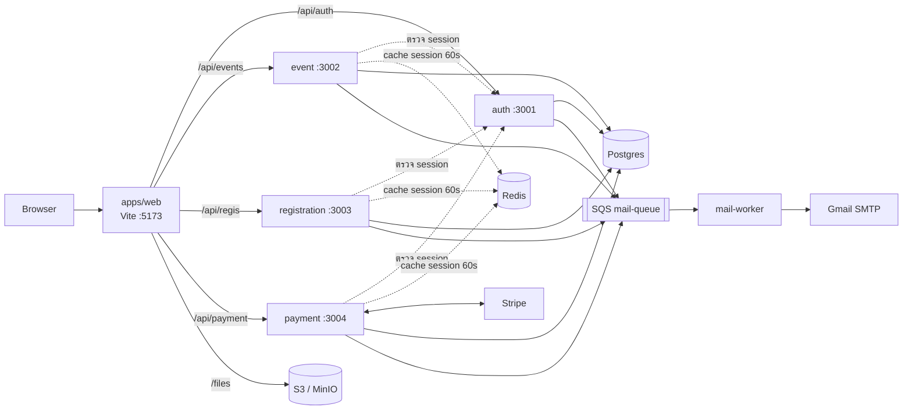
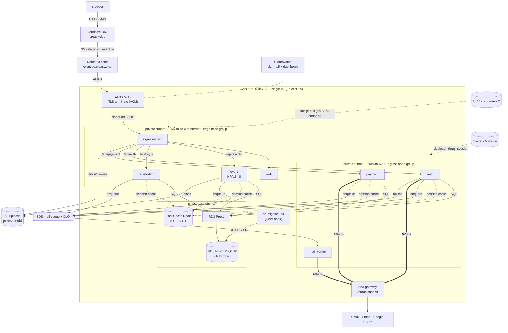
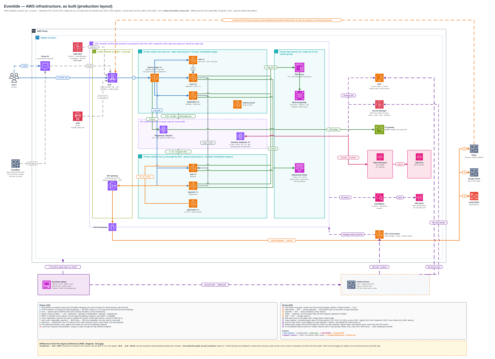

# Eventide

เว็บไซต์ขายและจัดการตั๋วอีเวนต์ สร้างเป็น monorepo ของ microservices บน [Bun](https://bun.com) และ deploy ขึ้น **Kubernetes (Amazon EKS)** ด้วย Terraform + Helm

- **Live:** https://eventide.creasy.club (รันบน AWS Academy Learner Lab ตอนเปิด session เท่านั้น)
- **หน้าเว็บ** เป็น React SPA ที่เรียก service ผ่าน Eden Treaty จึงได้ type จาก backend ถึง frontend โดยไม่ต้องเขียน API client เอง
- **แต่ละโดเมนเป็น service ของตัวเอง** (auth, event, registration, payment) แยก process และ port แต่ใช้ Postgres ก้อนเดียวกัน
- **งานที่ไม่ต้องรอ** อย่างการส่งอีเมล ส่งผ่านคิว SQS ให้ worker ทำ ไฟล์เก็บใน S3
- **Infrastructure เป็นโค้ดทั้งหมด** Terraform root เดียว สร้างและลบ EKS / RDS / ElastiCache / ALB + WAF ได้ด้วยคำสั่งเดียว (`make up` / `make down`)

## สารบัญ

1. [ความสามารถ](#ความสามารถ)
2. [สถาปัตยกรรมของแอป](#สถาปัตยกรรมของแอป)
3. [Infrastructure บน AWS](#infrastructure-บน-aws)
4. [เริ่มต้นใช้งาน (local)](#เริ่มต้นใช้งาน-local)
5. [คำสั่งที่ใช้บ่อย](#คำสั่งที่ใช้บ่อย)
6. [การทดสอบ](#การทดสอบ)
7. [โครงสร้างโปรเจกต์](#โครงสร้างโปรเจกต์)
8. [เอกสาร](#เอกสาร)

## ความสามารถ

| บทบาท | ทำอะไรได้ |
|---|---|
| ผู้ใช้ (`user`) | ค้นหาอีเวนต์ตามคำค้น หมวดหมู่ หรือผู้จัดงาน, ลงทะเบียนและชำระเงิน, ดูตั๋วพร้อม QR code, แก้โปรไฟล์, สมัครเป็นผู้จัดงาน |
| ผู้จัดงาน (`organizer`) | สร้างอีเวนต์ (ปก, แกลเลอรี, รายละเอียดแบบ rich text, ตั้งเวลาเผยแพร่), สร้างประเภทตั๋วและแบบฟอร์มลงทะเบียน, เชิญผู้เข้าร่วมทางอีเมล, อนุมัติหรือปฏิเสธการลงทะเบียน, ดูรายชื่อผู้เข้าร่วม ทำได้เฉพาะอีเวนต์ของตัวเอง |
| ผู้ดูแลระบบ (`admin`) | จัดการทุกอีเวนต์และหมวดหมู่, ระงับอีเวนต์หรือบัญชี, จัดการบัญชีผู้ใช้, อนุมัติใบสมัครผู้จัดงาน |

**ประเภทตั๋ว** มีสามแบบ:

- `first_come`: มาก่อนได้ก่อนตามโควตา (จองที่นั่งไว้ 10 นาทีตอนเปิดหน้าลงทะเบียน และเห็นที่นั่งว่างแบบ live ผ่าน WebSocket)
- `approval`: ผู้จัดอนุมัติทีละคน
- `invite`: เฉพาะอีเมลที่ได้รับเชิญ

ตั๋วฟรีหรือมีราคาก็ได้ ตั๋วที่มีราคาจ่ายผ่าน Stripe Checkout ถ้าเงินเข้าหลังที่นั่งหมด ระบบจะคืนเงินให้เอง

**ยังไม่เสร็จ:** เช็คอินผู้เข้าร่วม และหน้าคำขอคืนเงินใน dashboard

## สถาปัตยกรรมของแอป



- **Routing:** ตอน dev, Vite proxy แต่ละ path prefix ไปยัง port ของ service นั้น บน cluster ingress-nginx ทำหน้าที่เดียวกัน (ดู [Infrastructure](#infrastructure-บน-aws))
- **Session:** service อื่นตรวจ session โดยส่ง cookie ไปถาม `apps/auth` แล้ว cache คำตอบใน Redis 60 วินาที รายละเอียดอยู่ใน [docs/auth.md](docs/auth.md)

| Workspace | Port | Prefix | หน้าที่ |
|---|---|---|---|
| `apps/web` | 5173 (dev) / 3000 (prod) | | React SPA |
| `apps/auth` | 3001 | `/api/auth` | Better Auth: บัญชี, session, บทบาท, การระงับ, ใบสมัครผู้จัดงาน |
| `apps/event` | 3002 | `/api/events` | อีเวนต์, หมวดหมู่, รูปภาพ, คำเชิญ, ประเภทตั๋วและแบบฟอร์ม, รูป Open Graph |
| `apps/registration` | 3003 | `/api/regis` | ที่นั่งว่าง (พร้อม WebSocket), การลงทะเบียน (อนุมัติ / ปฏิเสธ), ตั๋วของฉัน |
| `apps/payment` | 3004 | `/api/payment` | Stripe Checkout, webhook, การคืนเงิน |
| `apps/mail-worker` | | | อ่านคิว `mail-queue` แล้วส่งอีเมลผ่าน Gmail |

| Package | หน้าที่ |
|---|---|
| `@app/db` | Drizzle schema, migration และ client ที่ทุก service ใช้ร่วมกัน |
| `@app/auth-guard` | บทบาทและสิทธิ์ (ใช้ใน web ด้วย), plugin `authGuard` ของ Elysia |
| `@app/mail` | สัญญาของคิวอีเมล: `enqueueMail()` และ `parseMailMessage()` |
| `@app/storage` | อัปโหลดไฟล์ลง S3 พร้อมตรวจชนิดและขนาดไฟล์ |
| `@app/tickets` | ออกตั๋วร่วมกันระหว่าง registration และ payment |

**Stack:**

| ส่วน | เทคโนโลยี |
|---|---|
| Frontend | React 19, Vite, TanStack Router / Query / Form / Table, shadcn/ui บน Base UI, Tailwind CSS 4 |
| Backend | ElysiaJS 2, Better Auth |
| ข้อมูล | Drizzle ORM บน Postgres, Redis 8 |
| ไฟล์และคิว | S3 (MinIO ตอน dev), SQS (ElasticMQ ตอน dev) |
| ภายนอก | Stripe, Gmail SMTP ผ่าน Nodemailer, Google OAuth |
| Infra | AWS (EKS, RDS + RDS Proxy, ElastiCache, ALB + WAF, NAT, VPC endpoints, ECR, S3, SQS, Route 53, ACM, CloudWatch, Secrets Manager), Terraform, Helm, ingress-nginx, k6 |

## Infrastructure บน AWS

รันบน **AWS Academy Learner Lab** (us-east-1) ซึ่งมีข้อจำกัดเยอะ (ดู [ข้อจำกัดของ lab](#ข้อจำกัดของ-lab-และวิธีรับมือ)) การออกแบบทั้งหมดจึงวนรอบสองเรื่อง คือ **งบ $50 ที่ห้ามเกิน** และ **สิทธิ์ IAM ที่ถูกตัด**

### ภาพรวม





แผนภาพข้างบนคือของที่ deploy จริง (ไอคอน AWS, ลูกศรทุกเส้นมีเลขและคำอธิบาย; [SVG](docs/architecture/aws/eventide-aws-as-built.svg) ซูมได้ชัดกว่า, [ไฟล์ `.drawio` แก้ไขได้และวิธี generate ใหม่](docs/architecture/aws/README.md)) ส่วน [`AWS_Diagram_Tool.jpg`](docs/architecture/aws/AWS_Diagram_Tool.jpg) คือสถาปัตยกรรมเป้าหมายที่เทียบด้วย ต่างกัน 3 จุดที่ lab บังคับ: **CloudFront → ALB + WAF**, NLB → ALB, Shield ใช้เฉพาะ Standard ที่มากับ ALB

### ส่วนประกอบ

| ชั้น | ทรัพยากร | รายละเอียด |
|---|---|---|
| คำนวณ | **EKS** 1.33 | raw `aws_eks_cluster` + managed node group **2 ชุด**: `edge` (private ไม่มี route ออก: ingress-nginx, event, registration, web) กับ `egress` (ออกผ่าน NAT: auth, payment, mail-worker) ค่าเริ่มต้น `t3.small`, ใช้ `t3.medium` ตอนทดสอบ HPA; chart ผูก pod เข้า tier ด้วย `nodeSelector eventide/tier` |
| ฐานข้อมูล | **RDS PostgreSQL 16** `db.t3.micro` + **RDS Proxy** | database เดียว (`eventide`) role เดียว, 20 GB, single-AZ ไม่มี backup (สร้างใหม่ทุก session); service ต่อผ่าน proxy (รวม pool ของทุก pod), migrate ต่อ RDS ตรง; master password ใน Secrets Manager (`eventide/rds-master`) |
| เครือข่าย | VPC เฉพาะ `10.20.0.0/16` (`network.tf`, ฟรี อยู่ถาวร) + **NAT gateway** + **VPC endpoint** | subnet public (ALB, NAT) / edge (ไม่มี route ออก) / egress (route ออก NAT) / data; endpoint: S3 (gateway), ecr.api, ecr.dkr, sts, ec2, sqs, secretsmanager (interface) ให้ tier edge เรียก AWS ได้; subnet ของ 1b มีเฉพาะที่ ALB, EKS และ RDS subnet group บังคับ |
| ทางเข้า | **ALB** + **WAFv2** (Terraform) → **ingress-nginx** (`NodePort` 30080) | ALB เป็นของ Terraform เพื่อไม่ให้ ELB หลุดจาก state (ห้ามใช้ `type=LoadBalancer`); WAF โหมด block: Common (ยกเว้น multipart upload), KnownBadInputs, IP reputation, rate limit ต่อ IP, เปิด path webhook ของ Stripe; idle timeout 3600 วินาทีสำหรับ WebSocket |
| TLS / DNS | **Route 53** + **ACM** wildcard cert | ALB ปลด TLS ที่ :443 (:80 → 301), Cloudflare ถือ apex `creasy.club` แล้ว delegate `eventide` มา Route 53 ด้วย NS 4 ตัว (`scripts/delegate-dns.sh` ทำให้เองเมื่อมี `CLOUDFLARE_API_TOKEN`) |
| Image | **ECR** × 7 + mirror × 2 | `auth` `event` `registration` `payment` `mail-worker` `web` `db-bootstrap` พร้อม lifecycle policy; mirror ของ ingress-nginx และ metrics-server (`make mirror`) เพราะ tier edge ดึงจาก registry สาธารณะไม่ได้ |
| ไฟล์ | **S3** | อัปโหลดผ่าน service เจ้าของ, ผู้ใช้อ่าน `/files/<key>` ที่ ingress rewrite ไป S3, bucket policy เปิดอ่านเฉพาะ `public/*` |
| คิว | **SQS** `eventide-mail-queue` + DLQ | ส่งซ้ำ 5 ครั้งแล้วเข้า DLQ |
| Secrets | **Secrets Manager** | `eventide/{rds-master,google-oauth,stripe,gmail}` |
| Cache | **ElastiCache Redis** (1 node, TLS + AUTH) | session cache ของ auth-guard, cache รายละเอียด event, pub/sub ที่นั่งว่าง ไม่มี snapshot (ถ้าหายแค่ช้าหนึ่ง request ไม่เคยผิด); บน k3d ยังเป็น Redis pod |
| Autoscaling | `metrics-server` + **HPA** บน `event` | 2 → 8 replica ที่ CPU 60% |
| สังเกตการณ์ | **CloudWatch** alarm 15 ตัว + dashboard `eventide`, SNS `eventide-alerts` | ALB 5xx/health/latency, RDS, RDS Proxy pinning, Redis, DLQ, CPU ของ node, WAF burst (SNS สมัครรับอีเมลด้วย `alert_email`) |
| CI/CD | GitHub Actions | `check` + `images` ทุก PR, `deploy` เมื่อ push เข้า `main` |

### Terraform: root เดียว state เดียว แยกชั้นด้วย `var.platform`

```
infra/terraform/
  network.tf ecr.tf s3.tf sqs.tf secrets.tf oauth.tf dns.tf   ← permanent: อยู่รอดหลัง make down (ฟรี/~$1 ต่อเดือน)
  platform.tf  modules/platform/                   ← nightly: EKS 2 node group, NAT + endpoints, RDS + Proxy,
                                                     ElastiCache, ALB + WAF, ALIAS record, CloudWatch alarms
                                                     + Helm release ingress-nginx, metrics-server
                                                     (ทั้งหมด count = var.platform ? 1 : 0)
```

เหตุผล: lab หยุดแค่ EC2 อัตโนมัติ ส่วน **EKS control plane, RDS + Proxy, ElastiCache, NAT, VPC endpoint, ALB และ WAF คิดเงินต่อเนื่อง** (ราว $0.5/ชม. ประมาณจากราคา) จึงต้องทิ้งทุกคืน แต่ network, image ใน ECR, ไฟล์ใน S3, คิว และ DNS delegation ห้ามหาย `make down` จึงเป็นแค่ `terraform apply -var platform=false` ที่ลบเฉพาะชั้น platform และ**จบด้วย exit ไม่ใช่ศูนย์ถ้าไม่สะอาดจริง** (apply ล้ม หรือรายการใดยังอยู่/อ่านไม่ได้)

- **State:** S3 `eventide-tfstate-<account>` (สร้างโดย `scripts/tf-init.sh`) ใช้ S3 lockfile ไม่ต้องมี DynamoDB; ถ้า run ถูกขัดจังหวะ (lab ตัด credential กลางทาง) `scripts/recover-state.sh` ปลดล็อกค้างและ push `errored.tfstate` ให้เองทุกครั้งที่ `tf-init` / `make down`
- **Credentials:** ที่เดียวคือ `infra/aws.env` (gitignored) ทุก Make target และ script อ่านไฟล์นี้ ไม่มีค่า account ID ฝังในโค้ด
- **Secrets เสริม** (เปิดด้วยไฟล์ `infra/terraform/*.auto.tfvars` ที่ gitignored): `dns` (Route 53 + ACM), `google`, `stripe`, `gmail`. ไม่มีไฟล์ = ฟีเจอร์นั้นปิด (ไม่มี Stripe = checkout ปิด, ไม่มี Gmail = mail-worker แค่ log)
- รายละเอียดทั้งหมด: [infra/terraform/README.md](infra/terraform/README.md)

### Kubernetes: Helm chart เดียวใช้ทั้ง EKS และ k3d

`infra/helm/eventide` มี workload ของทั้งระบบ (รายละเอียดใน [infra/helm/eventide/README.md](infra/helm/eventide/README.md))

| Workload | Kind | หมายเหตุ |
|---|---|---|
| `auth` `event` `registration` `payment` | Deployment + Service + Ingress path | probe ที่ `GET /api/<prefix>/health` |
| `web` | Deployment + Service + Ingress `/` | Bun server เสิร์ฟ `dist/` และใส่ `<head>` / Open Graph ต่อ URL |
| `mail-worker` | Deployment | SQS consumer ไม่มี HTTP จัดการ `SIGTERM` |
| `redis` | Deployment + Service | `redis:8-alpine` เฉพาะ k3d (บน EKS ใช้ ElastiCache: `values.aws.yaml` ตั้ง `redis: null` และ `REDIS_URL` มาจาก Secret) |
| `files` | ExternalName Service + Ingress `/files/(.*)` | rewrite ไป S3 (EKS) หรือ MinIO (k3d) |
| `db-migrate` | Job (hook `pre-install,pre-upgrade`) | `drizzle-kit migrate` ก่อน pod ใหม่ roll ทุกครั้งที่ deploy |
| `event` | HPA | เฉพาะ `values.aws.yaml`: 2 → 8 ที่ CPU 60% |

- ชุด values: `values.yaml` (ค่าเริ่มต้น), `values.local.yaml` (k3d: registry ในเครื่อง, 1 replica, MinIO), `values.aws.yaml` (EKS: ECR, 2 replica, HPA)
- **chart ไม่สร้าง Secret** `scripts/deploy.sh` สร้าง 4 ตัวทุก session: `eventide-common` (DB, S3, AWS session creds, queue URL), `eventide-auth` (Better Auth secret, Google), `eventide-payment` (Stripe), `eventide-mail-worker` (Gmail)
- **ทำไมไม่ใช้ IRSA / External Secrets:** lab ห้ามสร้าง OIDC provider pod จึงได้ AWS credentials ของ session ผ่าน Secret ซึ่ง**หมดอายุพร้อม session** ต้อง `make deploy` ใหม่ทุกครั้ง

### Image

Service ทั้ง 7 build จาก Bun คนละแบบตามสิ่งที่ต้องใช้ตอนรัน:

| Image | วิธี build | เพราะ |
|---|---|---|
| `auth` `registration` `payment` | `bun build --compile` เป็น binary | ไม่ต้องใช้ไฟล์ตอนรัน |
| `event` | bundle บน `oven/bun:1-slim` | OG renderer (`takumi-js` เป็น native addon + ฟอนต์จาก `node_modules`) |
| `mail-worker` | bundle บน `oven/bun:1-slim` | อ่าน `emails/static/logo.png` ตอนรัน |
| `web` | bundle + `dist/` บน `oven/bun:1-slim` | Bun server ใส่ `<head>` ต่อ URL |
| `db-bootstrap` | `drizzle-kit migrate` | ใช้เป็น migrate Job (≈ 250 MB) |

Container รันด้วย uid 1000, read-only filesystem และ drop ทุก capability

### Session lifecycle

Lab หมดอายุทุก 4 ชั่วโมง และถ้า reset lab ทุกอย่างหายหมด วงจรใช้งานจึงเหลือคำสั่งเดียว:

```sh
cp infra/aws.env.example infra/aws.env     # ครั้งเดียว แล้ววาง credential จาก Learner Lab → AWS Details → AWS CLI (ทุก session)

make deploy                                # คำสั่งเดียวจบ: account ว่าง / เพิ่ง reset → ระบบใช้งานได้ (platform รันอยู่แล้ว = redeploy)
make demo                                  # ใส่ข้อมูล demo ที่เตรียมไว้ (make deploy ทำให้เองตอนจบ) บัญชีอยู่ที่ demo/.credentials
make admin EMAIL=you@example.com           # ตั้ง admin เพิ่ม (บัญชี admin ของ demo มีให้แล้ว)
make load BASE_URL=https://eventide.creasy.club   # k6 ทดสอบ HPA
make down                                  # platform=false + พิสูจน์ว่าไม่มีอะไรคิดเงิน — ทำทุกครั้งก่อนจบ session
```

`make deploy` (`scripts/bootstrap.sh`) ทำตามลำดับ: ตรวจเครื่องมือ/Docker/credential → state ของ Terraform → ชั้นถาวร (VPC, ECR, S3, SQS, secrets, Route 53 zone, ขอ ACM cert) → ชี้ NS ที่ Cloudflare แล้วรอ cert เป็น `ISSUED` → คัดลอก image ของ ingress-nginx/metrics-server เข้า ECR → `terraform apply` ตัว platform → build/push/deploy แอป → ทดสอบ health ทั้ง 4 service → ใส่ข้อมูล demo (`SEED_DEMO=0` ข้าม) ถ้าเริ่มจากศูนย์ใช้เวลาราว 30–40 นาที (ยังไม่เคยทดสอบเส้นทางเริ่มจากศูนย์ครบวงจรกับ lab ที่ reset จริง)

- **ขั้นเดียวที่อาจต้องทำมือ:** reset ลบ Route 53 zone จึงได้ name server ชุดใหม่ ต้องเปลี่ยน NS ที่ Cloudflare ตาม ใส่ `CLOUDFLARE_API_TOKEN` ใน `infra/aws.env` (สิทธิ์ Edit zone DNS เฉพาะ zone หลัก) แล้วสคริปต์เปลี่ยนให้เอง ถ้าไม่ใส่ สคริปต์จะพิมพ์ NS 4 ตัวให้วางแล้วรอ (หรือจบด้วย exit 3 ถ้าไม่ได้รันใน terminal ให้วางแล้วรัน `make deploy` ซ้ำ)
- ฐานข้อมูลใหม่ทุก session จึงว่างเปล่า: `make deploy` ใส่ **ข้อมูล demo ที่เตรียมไว้** ให้ท้ายขั้นตอน (บัญชี admin / ผู้จัดที่อนุมัติแล้ว / ผู้เข้าร่วม, หมวดหมู่ที่มีชื่อไทยและอังกฤษ, อีเวนต์ 8 รายการครบทุกแบบของตั๋วและสถานะ) รหัสผ่านสุ่มอยู่ที่ `demo/.credentials` รายละเอียดใน [demo/README.md](demo/README.md)
- `make redeploy` = เฉพาะแอปบน platform ที่รันอยู่ (build/push 7 image, k8s Secrets, helm upgrade ผ่าน release gate ของ payment) ซึ่งเป็นสิ่งที่ CI รัน; `make up` / `make mirror` / `make secrets` ยังใช้ทีละขั้นได้
- ไม่ทำให้อัตโนมัติ: การวาง credential และ `make down` ตอนจบ session
- **ถ้า `make down` ถูกตัดกลางทาง** (lab ตัด credential): platform ยังคิดเงินอยู่ Start Lab ใหม่แล้วรัน `make down` ซ้ำ มันกู้ state เองก่อนแล้วทำลายส่วนที่เหลือ อย่ารัน `terraform apply` เองก่อน

`make plan` ดูสิ่งที่จะเปลี่ยนโดยไม่แก้อะไร, `NODE_INSTANCE_TYPE=t3.medium make deploy` สำหรับทดสอบ HPA ถึง 8 replica (t3.small รับได้แค่ ~11 pod; ยกเพดาน WAF ต่อ IP ด้วย `-var waf_rate_limit=…` เมื่อยิง k6 จากเครื่องเดียว)

**กฎ:** อย่าเริ่ม `terraform apply` ของ EKS หลังชั่วโมงที่ 3 ของ session และลืม `make down` ไม่ได้ เพราะทิ้งไว้ ~$0.5/ชม. ทำให้งบ $50 หมดภายในไม่กี่วัน

### Local parity: k3d

```sh
make k3d          # k3d + ingress-nginx + chart ชุดเดียวกับ EKS (ใช้ Postgres/MinIO/ElasticMQ จาก docker compose) → http://localhost:8080
make k3d-down
```

ใช้พิสูจน์ chart ก่อนเอาขึ้น EKS จึงไม่ต้องเปลืองเวลา session

### CI/CD

[`.github/workflows/ci.yml`](.github/workflows/ci.yml):

| Job | เมื่อไหร่ | ทำอะไร |
|---|---|---|
| `check` | PR และ `main` | เปิด compose stack, migrate, รัน test ทุก package/service/mail-worker, typecheck + build web |
| `images` | PR และ `main` | build ครบทั้ง 7 image |
| `deploy` | push เข้า `main` | `scripts/deploy.sh` แล้ว curl ตรวจ `/api/*/health` และ `/api/events/og/site` |

Lab ไม่มี OIDC federation จึง deploy ด้วย session credentials ที่เก็บเป็น GitHub secrets `AWS_*` (`make ci-creds DEPLOY=1` หลัง Start Lab ทุกครั้ง) job จะ **ข้ามพร้อม notice ไม่ใช่ fail** เมื่อ secrets หมดอายุหรือ platform ถูกปิด เพื่อไม่ให้ credential เก่าไปทับ cluster ที่ใช้งานอยู่ ส่วน `terraform apply` ยังสั่งมือ (`make up` / `make down`) เพื่อคุมค่าใช้จ่าย

### Autoscaling

`event` มี HPA 2 → 8 replica ที่ CPU 60% ทดสอบด้วย [`load/k6/events.js`](load/k6/events.js) (ยิง `GET /api/events` แบบ ramping VUs แล้วลดโหลดให้เห็น scale-down) ผลที่บันทึกไว้ใน [docs/autoscaling-evidence.txt](docs/autoscaling-evidence.txt): replica ขึ้น 2 → 3 → 5 → 7 → 8 แล้วลง 6 → 4 → 2

```sh
kubectl -n eventide get hpa event -w
kubectl -n eventide get pods -l app=event -w
```

HPA สูงสุด 8 เพราะ `t3.medium` รับได้ 17 pod ถ้าเกินนั้น pod จะค้าง `Pending` และดูเหมือนบั๊ก ขณะเดียวกัน `DB_POOL_MAX=4` ต่อ pod คือตัวเดียวที่คุมจำนวน connection (RDS `t3.micro` ≈ 87) ถ้าเพิ่ม replica โดยไม่ลดค่านี้ test จะล้มที่ connection ไม่ใช่ CPU

### ข้อจำกัดของ lab และวิธีรับมือ

| ข้อจำกัด | ผล |
|---|---|
| **งบ $50 ห้ามเกิน** เกินแล้วบัญชีถูกล็อกและงานหาย | ราว $2 ต่อ session 4 ชม. กับโครงสร้าง production (ประมาณจากราคา; ก่อนมี NAT/endpoint/Proxy/ElastiCache/ALB/WAF ~$1.10) → ทิ้ง platform ทุกครั้งด้วย `make down` |
| ไม่มี `iam:CreateRole` | ใช้ `LabEksClusterRole` / `LabEksNodeRole` ของ lab โดยค้นด้วย regex (`data "aws_iam_roles"`) ห้ามฝัง ARN |
| `iam:GetRole` บน `voclabs` ถูกปฏิเสธ | ใช้ `terraform-aws-modules/eks` ไม่ได้ → เขียน `aws_eks_*` ตรง ๆ |
| ไม่มี IRSA และไม่มี GitHub OIDC | pod และ CI ใช้ session credentials (หมดอายุพร้อม session) |
| SCP ปฏิเสธ `s3:GetBucketObjectLockConfiguration` | สร้าง bucket ด้วย CLI (`terraform_data` + `local-exec`) แล้วอ่านผ่าน `data "aws_s3_bucket"`, ตั้งค่าด้วย `aws_s3_bucket_*` |
| สร้าง VPC, NAT, VPC endpoint, ElastiCache, RDS Proxy, WAF ได้ (ตรวจแล้ว 2026-10-25) | ทำครบตามสถาปัตยกรรมเป้าหมายแบบ single-AZ; ราคาเพิ่ม ~$0.2/ชม. |
| CloudFront และ Shield Advanced ถูกปฏิเสธ | ใช้ **ALB + WAF** เป็นขอบแทน (Shield Standard มากับ ALB) และ ingress เสิร์ฟ `/files/*` จาก S3 ตรง |
| EC2 หยุดเองหลัง session แต่ ASG เปิดใหม่ | ต้องลบ platform ทั้งหมด ไม่ใช่รอให้ lab หยุดให้ |
| tier edge ไม่มี route ออก internet | pull image จาก Docker Hub / `registry.k8s.io` ไม่ได้ → ทุก image ต้องอยู่ใน ECR (`make mirror`) หรือไปรันบน tier egress |
| ไม่ใช่ production แท้ ๆ | single-AZ, ไม่มี backup ของ RDS, pod ใช้ credential 4 ชม., EKS API เปิดสาธารณะ, log ของ WAF/ALB ปิด, เปิดเฉพาะช่วง session |

หลัง lab reset ให้วาง credential ใหม่แล้วรัน `make deploy` (เปลี่ยน NS ที่ Cloudflare ให้เองเมื่อมี `CLOUDFLARE_API_TOKEN` ดู [Session lifecycle](#session-lifecycle)) `bash scripts/check-lab.sh` ใช้ตรวจสิทธิ์ของ lab ได้เมื่อสงสัย

### กฎที่ทำให้เสียเวลาถ้าฝ่าฝืน

- **Health endpoint ห้ามแตะ Postgres หรือ Redis** probe ที่ query DB ทำให้ RDS สะดุด 5 วินาทีกลายเป็น pod restart ทั้งระบบ
- **`/files/*` เปิดสาธารณะเฉพาะ `public/*`** ห้ามเก็บไฟล์ private ด้วย key `public/` และห้ามขยาย bucket policy
- RDS ต้องตั้ง `skip_final_snapshot = true` และ `deletion_protection = false` ไม่งั้น `make down` ล้ม
- ห้ามสร้าง ELB ด้วย `type=LoadBalancer` (ใช้ ALB ของ Terraform)
- **เปลี่ยน VPC หรือ subnet = สร้าง EKS, DB subnet group และ load balancer ใหม่:** `make down` ก่อนเสมอ (จาก checkout ที่โค้ดตรงกับของที่รันอยู่) แล้วค่อย apply
- **เส้นทางออกของ tier edge:** อย่าให้ pod ที่ไม่ใช่ egress เรียก internet โดยตรง (จะ timeout) และอย่าเพิ่ม image จาก registry สาธารณะโดยไม่ mirror
- Bun service ต้องรับ `SIGTERM`

### อ่านต่อ

| ไฟล์ | เนื้อหา |
|---|---|
| [docs/SYSTEM-DESIGN.md](docs/SYSTEM-DESIGN.md) | สถาปัตยกรรมและ IaC layout (§1.1 สรุปสิ่งที่เปลี่ยนตอน merge v2) |
| [docs/PROJECT-KNOWLEDGE-BASE.md](docs/PROJECT-KNOWLEDGE-BASE.md) | log การตัดสินใจ, ข้อจำกัดที่ตรวจจริง, ตาราง trap |
| [docs/TODO.md](docs/TODO.md) | checklist พร้อม GATE |
| [docs/DEMO-RUNSHEET.md](docs/DEMO-RUNSHEET.md) | ลำดับการ demo |
| [docs/architecture/aws/](docs/architecture/aws/README.md) | แผนภาพ AWS as-built |
| `docs/lab-probe-2026-09-0{6,7}.txt` | ผลตรวจสิทธิ์ของ lab |

## เริ่มต้นใช้งาน (local)

ต้องมี [Bun](https://bun.com) 1.4 ขึ้นไป และ Docker (พร้อม Compose)

```sh
bun install
cp .env.example .env        # ทุก workspace อ่าน .env ที่ root
```

เปิด `.env` แล้วใส่ `BETTER_AUTH_SECRET` (สร้างด้วย `openssl rand -base64 32`) ค่าอื่นใช้ค่าเริ่มต้นได้เลย

```sh
bun run infra:up            # Postgres, Redis, ElasticMQ, MinIO
bun run db:migrate
bun run dev                 # web + ทุก service + mail worker
```

(หรือ `make dev` ทำสามขั้นนี้ให้)

1. เปิด http://localhost:5173 แล้วสมัครสมาชิก
2. ตั้งบัญชีแรกเป็นผู้ดูแลระบบ แล้ว reload หน้าเว็บ:

   ```sh
   cd apps/auth && bun run admin:promote you@example.com
   ```

3. สร้างหมวดหมู่ที่ `/dashboard/categories` ก่อน เพราะอีเวนต์ทุกอันต้องมีหมวดหมู่

หน้า `/status` แสดงสถานะของทุก service

### ตัวเลือกเสริม

ส่วนนี้ไม่ต้องตั้งก็รันได้

| ฟีเจอร์ | ตั้งค่า | ถ้าไม่ตั้ง |
|---|---|---|
| เข้าสู่ระบบด้วย Google | `GOOGLE_CLIENT_ID`, `GOOGLE_CLIENT_SECRET` (redirect URI: `http://localhost:5173/api/auth/callback/google`) | มีแค่อีเมลและรหัสผ่าน |
| ชำระเงิน | `STRIPE_SECRET_KEY` (sandbox key) และ `STRIPE_WEBHOOK_SECRET` จาก `bun run stripe:listen` ดูขั้นตอนใน [docs/stripe.md](docs/stripe.md) | ตั๋วฟรีใช้ได้ แต่ตั๋วที่มีราคาจ่ายเงินไม่ได้ |
| ส่งอีเมลจริง | `GMAIL_USER`, `GMAIL_APP_PASSWORD` ([App Password](https://myaccount.google.com/apppasswords)) | mail worker พิมพ์อีเมลลง log แทนการส่ง |

บน AWS Google ใช้ได้เฉพาะเมื่อ public URL เป็น `https://` (Google ไม่รับ redirect URI แบบ http) และ Stripe webhook ชี้ที่ `https://eventide.creasy.club/api/payment/webhook`

### บริการในเครื่อง

| บริการ | ที่อยู่ | หมายเหตุ |
|---|---|---|
| Postgres 18 | `localhost:5432` | `bun run db:studio` เปิด Drizzle Studio |
| Redis 8 | `localhost:6379` | |
| ElasticMQ (SQS) | API `:9324`, UI http://localhost:9325 | คิว `mail-queue` และ `mail-dlq` |
| MinIO (S3) | API `:9000`, console http://localhost:9001 | login `minioadmin` / `minioadmin`, bucket `event-assets` |

`bun run infra:down` หยุดบริการ และ `bun run infra:reset` ล้างข้อมูลทั้งหมดแล้วเริ่มใหม่ (`make db-reset` ล้างแล้ว migrate ให้ด้วย)

## คำสั่งที่ใช้บ่อย

```sh
bun run dev                         # ทุก app พร้อมกัน
bun run --filter @app/event dev     # app เดียว

bun run db:generate                 # สร้าง migration จาก schema ที่แก้ (packages/db/drizzle/)
bun run db:migrate                  # รัน migration

bun run --filter @app/web lint      # oxlint
bun run --filter @app/web build     # tsc -b && vite build
bun run --filter @app/web start     # production server ของเว็บ (dist/ + Open Graph ต่อ URL)
bun run --filter @app/mail-worker preview   # ดูตัวอย่างอีเมลทุก template ที่ :3010

make help                           # รายการ Make target ทั้งหมด (dev, k3d, up, deploy, down, ...)
```

**Type check:** รัน `bun check` จาก**ใน** workspace เช่น `cd apps/web && bun check` อย่ารันที่ root เพราะ tsconfig ที่ root ไม่มี DOM lib และ alias `@/*` จึงรายงาน error ที่ไม่มีจริงใน `apps/web`

## การทดสอบ

ใช้ `bun test` ชุดทดสอบที่ต้องใช้ฐานข้อมูลหรือ Redis ต้อง `bun run infra:up` ก่อน แล้วรันจากใน workspace:

```sh
cd apps/event && bun run test       # หรือ apps/auth, apps/registration, apps/payment,
                                    # packages/auth-guard, packages/storage
cd apps/mail-worker && bun run test # render ทุก template ไม่ต้องมี infra
bun test test/event.test.ts         # ไฟล์เดียว
bun test -t "pattern"               # เฉพาะเทสต์ที่ชื่อตรง
bash scripts/lib.test.sh            # ทดสอบ shell helper ของ deploy script
```

ส่วน infra ตรวจโดยไม่ต้องมี credential ได้:

```sh
terraform -chdir=infra/terraform init -backend=false && terraform -chdir=infra/terraform validate
terraform -chdir=infra/terraform fmt -check -recursive
helm lint infra/helm/eventide -f infra/helm/eventide/values.yaml -f infra/helm/eventide/values.local.yaml
```

## โครงสร้างโปรเจกต์

```
apps/
  web/            React SPA (TanStack Router แบบ file-based ใน src/routes/) + server/ สำหรับ production
  auth/           Better Auth
  event/          อีเวนต์ หมวดหมู่ คำเชิญ ประเภทตั๋ว
  registration/   การลงทะเบียนและตั๋ว
  payment/        Stripe
  mail-worker/    ส่งอีเมลจากคิว (React Email)
packages/
  db/  auth-guard/  mail/  storage/  tickets/
infra/
  elasticmq/      ค่าตั้งคิวของ ElasticMQ สำหรับ docker-compose
  terraform/      root เดียว: VPC, ECR, S3, SQS, secrets, DNS + modules/platform (EKS, NAT, endpoints, RDS + Proxy, ElastiCache, ALB + WAF, alarms) สลับด้วย var.platform
  helm/eventide/  Helm chart ของทั้งระบบ (ใช้ชุดเดียวกันทั้ง k3d และ EKS)
  aws.env.example ที่วาง credential ของ Learner Lab (copy เป็น aws.env)
scripts/          bootstrap (make deploy) · deploy (make redeploy) · tf-init · recover-state · teardown · delegate-dns · mirror-images · k3d-up · k3d-down · admin · check-lab · sync-secrets · ci-creds
load/k6/          load test สำหรับ HPA
.github/workflows/ci.yml   check, images, deploy
docs/             เอกสารออกแบบ + รายงาน + แผนภาพ
```

แต่ละ service จัดโค้ดเป็น `src/routes/<feature>/{index,model,service}.ts`: controller, schema ของ request/response และ business logic

## เอกสาร

- [docs/auth.md](docs/auth.md): การยืนยันตัวตน บทบาท และการตรวจสิทธิ์ข้าม service
- [docs/tickets.md](docs/tickets.md): ประเภทตั๋ว วงจรการลงทะเบียน การล็อกที่นั่ง และการชำระเงิน
- [docs/stripe.md](docs/stripe.md): ตั้งค่า Stripe ตั้งแต่ sandbox จนถึง webhook บน production
- [docs/storage.md](docs/storage.md): การอัปโหลดและเก็บไฟล์
- [infra/terraform/README.md](infra/terraform/README.md) และ [infra/helm/eventide/README.md](infra/helm/eventide/README.md): รายละเอียด infra
- [CLAUDE.md](CLAUDE.md): ข้อตกลงในการเขียนโค้ดของโปรเจกต์ทั้งหมด
