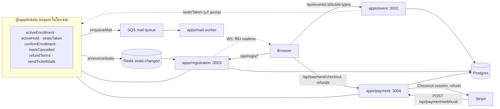
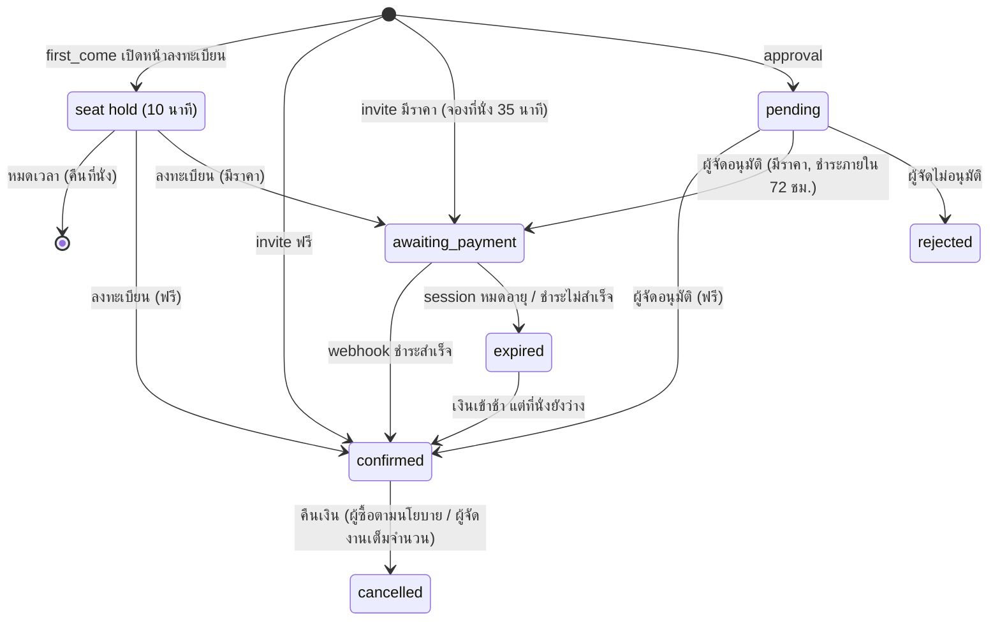
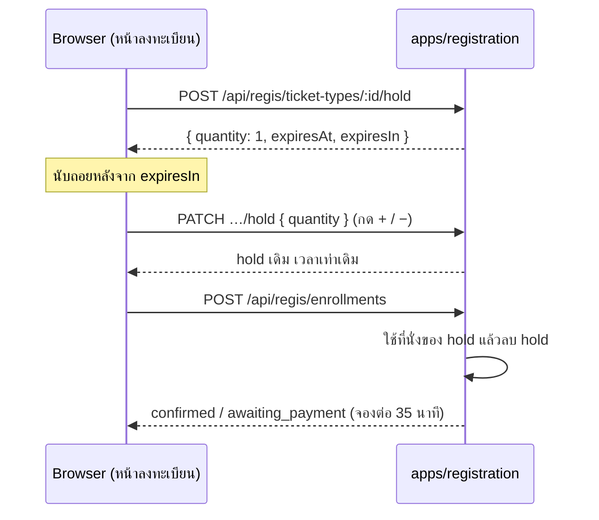
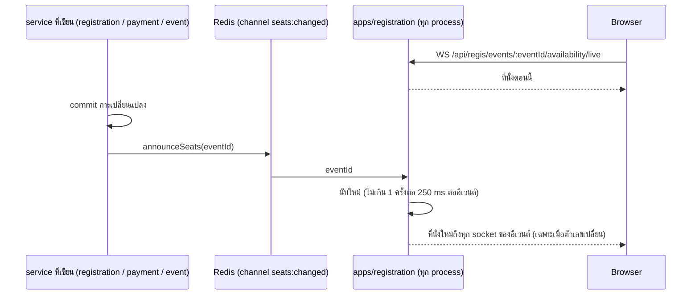
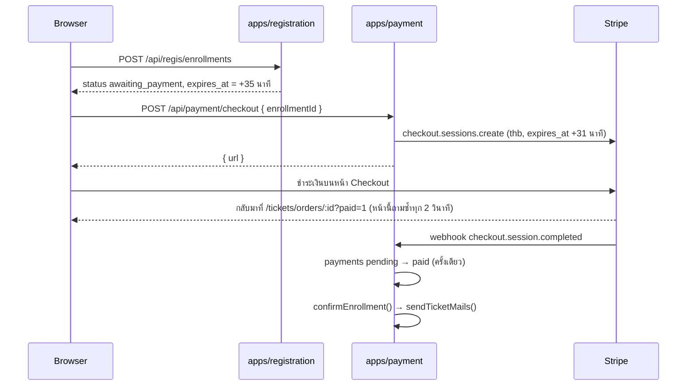
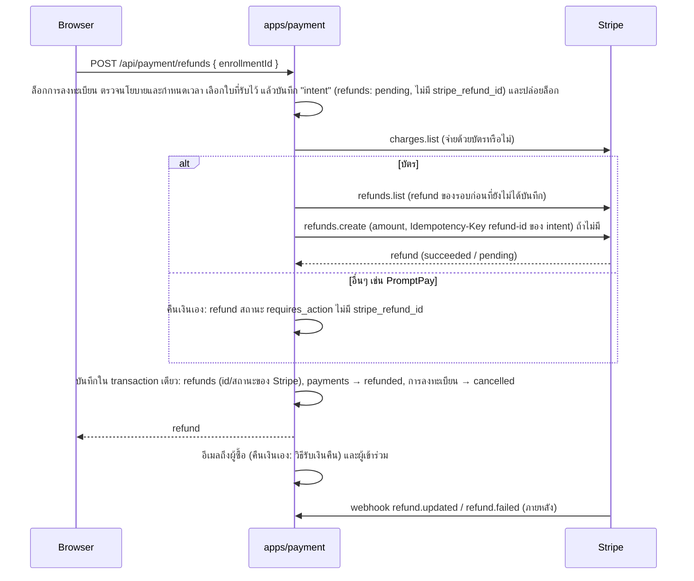

# ระบบตั๋ว (Tickets)

เอกสารนี้อธิบายว่า Eventide ขายและแจกตั๋วอย่างไร ตั้งแต่ผู้จัดสร้างประเภทตั๋วและแบบฟอร์ม จนถึงผู้ซื้อลงทะเบียน ชำระเงิน และผู้เข้าร่วมเห็นตั๋วในบัญชี

- **สาม service แบ่งกันถือข้อมูล:** `apps/event` ถือประเภทตั๋วและแบบฟอร์ม, `apps/registration` ถือการลงทะเบียนและตั๋ว, `apps/payment` ถือการชำระเงินและการคืนเงินผ่าน Stripe
- **`@app/tickets` เป็น library ไม่ใช่ service:** โค้ดที่ registration และ payment ต้องใช้ร่วมกัน (นับที่นั่ง, ยืนยันการลงทะเบียน, ส่งอีเมลตั๋ว) อยู่ที่นี่ ทุก service ใช้ DB เดียวกัน
- **ตั๋ว 1 ใบ = ผู้เข้าร่วม 1 คน:** ผู้ซื้อกรอกชื่อ นามสกุล อีเมล และคำตอบให้ผู้เข้าร่วมทีละคน ตั๋วส่งไปที่อีเมลนั้น และแสดงในบัญชีที่ใช้อีเมลนั้นด้วย

## สารบัญ

1. [ภาพรวม](#1-ภาพรวม)
2. [ประเภทตั๋ว](#2-ประเภทตั๋ว)
3. [แบบฟอร์มลงทะเบียน](#3-แบบฟอร์มลงทะเบียน)
4. [วงจรของการลงทะเบียน](#4-วงจรของการลงทะเบียน)
5. [ที่นั่งและการล็อก](#5-ที่นั่งและการล็อก)
6. [การชำระเงิน](#6-การชำระเงิน)
7. [การคืนเงิน](#7-การคืนเงิน)
8. [ตั๋วของฉัน](#8-ตั๋วของฉัน)
9. [Endpoint และสิทธิ์](#9-endpoint-และสิทธิ์)
10. [เมื่อมีส่วนใดล่ม และข้อจำกัดที่รู้อยู่](#10-เมื่อมีส่วนใดล่ม-และข้อจำกัดที่รู้อยู่)
11. [การทดสอบและการตั้งค่า](#11-การทดสอบและการตั้งค่า)
12. [ไฟล์ที่เกี่ยวข้อง](#12-ไฟล์ที่เกี่ยวข้อง)

---

## 1. ภาพรวม

| ตาราง | เจ้าของ | เก็บอะไร |
|---|---|---|
| `ticket_types` | apps/event | ประเภท (`kind`), ชื่อ, รายละเอียด, ราคา (บาท), `quota`, `max_per_user` |
| `ticket_type_questions` | apps/event | คำถามของแต่ละประเภท เรียงด้วย `position` |
| `seat_holds` | apps/registration | ที่นั่งที่บัญชีจองไว้ระหว่างกรอกแบบฟอร์ม (first_come): จำนวน, `expires_at` บัญชีละ 1 แถวต่อประเภทตั๋ว |
| `enrollments` | apps/registration | การลงทะเบียน 1 ครั้ง: ผู้ซื้อ, จำนวน, ราคาต่อใบและนโยบายคืนเงิน ณ ตอนนั้น, สถานะ, `expires_at` |
| `tickets` | apps/registration | ผู้เข้าร่วม 1 คน: ชื่อ, อีเมล (ตัวเล็ก), `code` สำหรับ QR, `answers` |
| `payments` | apps/payment | Checkout session ของ Stripe ต่อการลงทะเบียน |
| `refunds` | apps/payment | การคืนเงินของ Stripe ไม่เกิน 1 ครั้งต่อการชำระเงิน: ยอด, เปอร์เซ็นต์, สถานะ, ใครขอคืน |

## 2. ประเภทตั๋ว

| `kind` | ชื่อในเว็บ | จำนวนตั๋ว | ใครลงทะเบียนได้ |
|---|---|---|---|
| `first_come` | มาก่อนได้ก่อน | ต้องกำหนด `quota` | ทุกคนที่เปิดอีเวนต์ได้ |
| `approval` | ต้องได้รับอนุมัติ | ไม่จำกัด | ทุกคนที่เปิดอีเวนต์ได้ แล้วผู้จัดอนุมัติทีละรายการ |
| `invite` | เฉพาะผู้ได้รับเชิญ | ไม่จำกัด (จำกัดด้วยรายชื่อเชิญ) | อีเมลใน `event_invitations` คำเชิญละ 1 การลงทะเบียน |

- **ราคา** เป็นจำนวนเต็มบาท 0 คือฟรี ตั๋วที่ขายต้องราคาอย่างน้อย ฿20 เพราะ Stripe ไม่รับยอดต่ำกว่าราว $0.50 หลังแปลงสกุล
- **`max_per_user`** (1–10) นับรวมทุกการลงทะเบียนที่ยัง active ของบัญชีเดียวกันในประเภทนั้น ลงทะเบียนหลายครั้งก็เลี่ยงไม่ได้
- **แก้ประเภทตั๋วหลังมีคนลงทะเบียน:** เปลี่ยน `kind` ไม่ได้ (`KIND_LOCKED`), ลด `quota` ให้ต่ำกว่าที่จองไปแล้วไม่ได้ (`QUOTA_BELOW_TAKEN`), ลบไม่ได้ (`TICKET_TYPE_IN_USE`) แก้ราคาได้ เพราะการลงทะเบียนเก็บราคาต่อใบของตัวเองไว้แล้ว
- อีเวนต์ที่มีการลงทะเบียนลบไม่ได้ (`EVENT_HAS_ENROLLMENTS`) และคำเชิญที่ผูกกับการลงทะเบียนลบหรือเปลี่ยนอีเมลไม่ได้ (`INVITATION_USED`) ทั้งหมดมาจาก foreign key แบบ `ON DELETE RESTRICT`

## 3. แบบฟอร์มลงทะเบียน

- **ช่องบังคับของระบบ:** ชื่อ นามสกุล อีเมล มีในตั๋วทุกใบ ไม่ได้เก็บเป็นคำถาม หน้าแก้ไขแสดงเป็นแถวที่ล็อกไว้
  - ตั๋วใบแรกเติมจาก `users.first_name` / `last_name` (Better Auth `additionalFields` แก้ได้ที่ `/profile` และดึงจาก Google ตอนสมัคร) ถ้าว่างจะแยกจาก `users.name` ผู้ซื้อแก้ได้เสมอ
- **คำถามของผู้จัด** แยกตามประเภทตั๋ว รูปแบบ: ข้อความสั้น (≤ 200 ตัวอักษร), ข้อความยาว (≤ 2,000), ตัวเลือก (เลือก 1 ข้อ 2–20 ตัวเลือกที่ไม่ซ้ำ) แต่ละข้อตั้ง "จำเป็นต้องตอบ" ได้ สูงสุด 30 ข้อ
- **บันทึกทั้งรายการ:** `PATCH /:id/ticket-types/:ticketTypeId` ที่มี `questions` จะแทนที่รายการเดิม ข้อที่ส่ง `id` เดิมมาจะถูกแก้ในที่เดิม ข้อที่หายไปถูกลบ ข้อใหม่ถูกเพิ่ม และลำดับตามตำแหน่งใน array
- **คำตอบเป็นสำเนา:** ตั๋วเก็บ `{ questionId, label, value }` ตอนลงทะเบียน แก้หรือลบคำถามภายหลังจึงไม่กระทบคำตอบที่มีอยู่
- **เรียงลำดับด้วยการลาก:** หน้าแก้ไขใช้ `@dnd-kit/react` ลากที่ไอคอนจับ (หรือโฟกัสไอคอนแล้วกด Space, ลูกศร, Space) ระหว่างลาก การ์ดอื่นยุบเหลือหัวข้อ เพราะการ์ดตัวเลือกสูงกว่าการ์ดข้อความมาก ถ้าไม่ยุบ ตัวชี้จะไปอยู่บนการ์ดอีกใบหลังสลับ แล้วสลับกลับทันที

## 4. วงจรของการลงทะเบียน

- **Seat hold** ไม่ใช่การลงทะเบียน แต่เป็นแถวใน `seat_holds` ที่กันที่นั่งไว้ก่อนมีการลงทะเบียน ดู[หัวข้อ 5](#จองที่นั่งระหว่างกรอกแบบฟอร์ม-seat-hold) การลงทะเบียน `awaiting_payment` ของ first_come จึงจองต่อจาก seat hold อีก 35 นาที
- **Active** (`activeEnrollment()`) = `confirmed`, `pending`, หรือ `awaiting_payment` ที่ `expires_at` ยังไม่ถึง การลงทะเบียน active เท่านั้นที่นับที่นั่ง นับ `max_per_user` และถือคำเชิญ
- **การจองที่หมดเวลา** หยุดนับทันทีโดยไม่ต้องมี job ตั้งเวลา สถานะในตารางยังเป็น `awaiting_payment` จนกว่า webhook `checkout.session.expired` จะมาเปลี่ยน ระหว่างนั้นทุก endpoint อ่านเป็น `expired` (`effectiveStatus()`)
- **ยกเลิกแล้ว** (`markCancelled()`) ตั้ง `cancelled_at` และล้าง `used_at` ของคำเชิญ ผู้ได้รับเชิญจึงลงทะเบียนใหม่ได้ การลงทะเบียนที่ยกเลิกแล้วไม่กลับมายืนยันอีก ถ้ามีเงินเข้ามาภายหลังจะถูกคืน ดู[หัวข้อ 7](#7-การคืนเงิน)
- **ยืนยันแล้ว** (`confirmEnrollment()` / `markConfirmed()`) ตั้ง `confirmed_at`, ล้าง `expires_at` และตั้ง `used_at` ของคำเชิญ (ตั๋ว invite) จากนั้น `sendTicketMails()` ส่งอีเมลถึงผู้เข้าร่วมทุกคนพร้อมรหัสตั๋ว ลิงก์ไป `/tickets/:id` หรือหน้าสมัครสมาชิกถ้าอีเมลนั้นยังไม่มีบัญชี

## 5. ที่นั่งและการล็อก

ทุกขั้นที่ตรวจที่นั่งเทียบ `quota` จะล็อกแถว `ticket_types` ก่อน (`SELECT … FOR UPDATE`) จึงไม่มีสองคำขอที่ได้ที่นั่งสุดท้ายพร้อมกัน ที่นั่งที่ถูกใช้ (`seatsTaken()`) = ตั๋วของการลงทะเบียน active + ที่นั่งของ seat hold ที่ยังไม่หมดเวลา (`activeHold()`):

- **จองที่นั่ง** (`startHold()` / `resizeHold()`): ล็อกประเภทตั๋ว → ตรวจ `max_per_user` (ตั๋วที่มีอยู่ + ที่จะจอง) → ตรวจที่นั่งโดยไม่นับ hold ของตัวเอง → บันทึก hold
- **ลงทะเบียน** (`enroll()`): ล็อกประเภทตั๋ว → ตรวจ `max_per_user` → ตรวจที่นั่งโดยไม่นับ hold ของผู้ซื้อเอง → (invite) ล็อกแถวคำเชิญและตรวจว่ายังไม่มีการลงทะเบียน active อื่นใช้อยู่ → บันทึกการลงทะเบียนและตั๋ว แล้วลบ hold ของผู้ซื้อ
- **แก้ quota / kind** (`updateTicketType()`): ล็อกแถวเดียวกันก่อนนับ ที่นั่งที่มีคนจองระหว่างกรอกแบบฟอร์มก็นับด้วย จึงลด quota ต่ำกว่านั้นหรือเปลี่ยน kind ไม่ได้จนกว่า hold จะหมดเวลา
- **ยืนยันหลังจองหมดเวลา** (`confirmEnrollment()`): ล็อกการลงทะเบียนและประเภทตั๋ว แล้วนับที่นั่งใหม่โดยไม่รวมตัวเอง ถ้าไม่พอคืน `SoldOut`

`test/enrollment.test.ts` ยิงลงทะเบียน 6 คำขอพร้อมกันกับ quota 3 และคาดว่าสำเร็จพอดี 3 `test/seat-hold.test.ts` ทำแบบเดียวกันกับการจองที่นั่ง

### จองที่นั่งระหว่างกรอกแบบฟอร์ม (seat hold)

ตั๋ว first_come (ประเภทเดียวที่มี `quota`) จองที่นั่งให้ทันทีที่ผู้ซื้อเปิดหน้าลงทะเบียน ผู้ซื้อมีเวลากรอกข้อมูล 10 นาที (`SEAT_HOLD_MS`) โดยไม่มีใครแย่งที่นั่งนั้นไปได้

- **บัญชีละ 1 hold ต่อประเภทตั๋ว** (unique `ticket_type_id, holder_id`) `POST` ซ้ำระหว่างที่ hold ยังไม่หมดเวลาจะได้ hold เดิมกลับมา (จำนวนและเวลาเท่าเดิม) รีเฟรชหน้าหรือเปิดจากอุปกรณ์อื่นจึงได้สิทธิ์เดิมต่อ ส่วนข้อมูลที่กรอกไว้ไม่ตามไปด้วย
- **เริ่มที่ 1 ที่นั่ง** ปุ่ม + / − ปรับจำนวนผ่าน `PATCH` ซึ่งตรวจ `max_per_user` และที่นั่งเหมือนตอนจอง ถ้าเพิ่มไม่ได้ (`SOLD_OUT`, `LIMIT_REACHED`) จำนวนในฟอร์มไม่เปลี่ยน
- **หมดเวลา:** hold เลิกนับทันทีที่ `expires_at` ผ่านไป ไม่ต้องมี job ตั้งเวลา (แบบเดียวกับการจองระหว่างชำระเงิน) feed นับใหม่ตอนนั้นและส่งที่นั่งคืนให้ทุกคน หน้าเว็บปิดปุ่มลงทะเบียนและแสดง "จองที่นั่งใหม่" ข้อมูลที่กรอกไว้ยังอยู่ ถ้าที่นั่งยังว่างก็จองใหม่ได้ (เริ่มนับ 10 นาทีใหม่) `PATCH` หลังหมดเวลาได้ `HOLD_EXPIRED`
- **ลงทะเบียน:** `enroll()` ไม่นับที่นั่งของ hold ของผู้ซื้อเอง แล้วลบ hold ใน transaction เดียวกับที่บันทึกการลงทะเบียน ตั๋วฟรีเป็น `confirmed` ตั๋วมีราคาเป็น `awaiting_payment` และจองต่ออีก 35 นาทีตาม[หัวข้อ 6](#6-การชำระเงิน) ถ้า hold หมดเวลาไปแล้วแต่ที่นั่งยังว่าง ก็ยังลงทะเบียนได้ ถ้าไม่ว่างได้ `SOLD_OUT`
- **ที่นั่งเต็มเพราะ hold ของตัวเอง:** `GET …/availability` คืน `hold` ของผู้ถาม และ `state` เป็น `open` แม้ `remaining` เป็น 0 (`withLiveSeats()` ในเว็บทำแบบเดียวกัน) หน้าอีเวนต์เปลี่ยนปุ่มเป็น "กรอกข้อมูลต่อ"
- **นาฬิกา:** `expires_at` คิดจากนาฬิกาของ service และ DB เป็นตัวตัดสินว่าหมดเวลาหรือยัง เว็บนับถอยหลังจาก `expiresIn` (มิลลิวินาทีที่เหลือตอนตอบ) ไม่ใช้ `expiresAt` ตรงๆ เพราะนาฬิกาของเครื่องผู้ใช้อาจเพี้ยน
- **แถวที่หมดเวลา** ถูกลบตอนมีคนจองประเภทตั๋วเดียวกันครั้งถัดไป หรือตอนลงทะเบียน แถวที่ค้างไว้ไม่มีผลกับการนับ
- approval และ invite ไม่จอง (`NOTHING_TO_HOLD`) approval ไม่มี quota ส่วน invite ถือสิทธิ์ด้วยคำเชิญอยู่แล้ว

### ตัวเลขที่นั่งแบบ realtime

หน้าอีเวนต์ หน้าลงทะเบียน และหน้าประเภทตั๋วของผู้จัด เปิด WebSocket ไว้ แล้วได้ตัวเลขใหม่ทันทีที่ที่นั่งเปลี่ยน ไม่ต้องรีเฟรชหรือถามซ้ำ

- **ใครประกาศ:** ทุกจุดที่เปลี่ยนจำนวนที่นั่งหรือรายการประเภทตั๋วเรียก `announceSeats(eventId)` จาก `@app/tickets` หลัง transaction commit ได้แก่ จอง/ปรับจำนวน seat hold, ลงทะเบียน, อนุมัติ/ไม่อนุมัติ, ยืนยัน (`confirmEnrollment()`), session ของ Stripe หมดอายุ, คืนเงิน และสร้าง/แก้/ลบประเภทตั๋ว โค้ดใหม่ที่เปลี่ยนที่นั่งต้องเรียกด้วย
- **ประกาศแบบไม่รอ:** `announceSeats()` ไม่ throw และไม่รอ Redis คำขอเดิมจึงไม่ช้าลงหรือล้มเพราะ Redis
- **นับครั้งเดียวให้ทุกคน:** แต่ละ process ของ registration นับใหม่เฉพาะอีเวนต์ที่ socket ของตัวเองดูอยู่ แล้วส่งผ่าน Bun pub/sub (`server.publish`) ถึงทุก socket ในครั้งเดียว ภาระของ Postgres จึงขึ้นกับจำนวนการเปลี่ยนแปลง ไม่ใช่จำนวนคนเปิดดู การเปลี่ยนแปลงที่ถี่กว่า 250 ms รวมเป็นการนับครั้งเดียว
- **การจองที่หมดเวลา:** ตอนนั้นไม่มีอะไรถูกเขียนลง DB feed จึงตั้งเวลานับใหม่ไว้ที่ `expires_at` ที่ใกล้ที่สุดของอีเวนต์ ทั้งของการลงทะเบียนที่รอชำระและของ seat hold (เผื่อ 100 ms เพราะนาฬิกาของ DB เป็นตัวตัดสิน)
- **Socket ส่งเฉพาะตัวเลขที่เหมือนกันทุกคน** (`confirmed`, `reserved`, `pending`, `held`, `remaining`) ส่วน `mine`, `hold` และ `state` ของผู้ดูยังมาจาก `GET …/availability`
  - เว็บ (`useLiveSeats()` ใน `apps/web/src/lib/live-seats.ts`) เอาตัวเลขใหม่ทับ query เดิม และคิด `sold_out` / `open` ใหม่ด้วย `withLiveSeats()` ซึ่งต้องตรงกับ `getAvailability()`
  - ถ้าประเภทตั๋วเพิ่มหรือหายไป เว็บโหลดรายการประเภทตั๋วและ availability ใหม่
- **สิทธิ์:** ตรวจกฎเดียวกับ GET ตอน socket เปิด ไม่ผ่านจะปิดด้วย code `4000 + status` (`4404` `EVENT_NOT_FOUND`, `4403` `INVITE_ONLY`) เว็บเห็น code 4xxx แล้วจะไม่ต่อใหม่ ถ้าหลุดด้วยเหตุอื่น เว็บต่อใหม่ทุก 1, 2, 4 … วินาที (สูงสุด 30) และได้ตัวเลขล่าสุดทันทีที่ต่อติด

## 6. การชำระเงิน

- **ไม่จ่ายซ้ำ:** checkout ล็อกแถวการลงทะเบียน และถ้ามี session ที่ยังเปิดอยู่จะคืน URL เดิม
- **Webhook ไม่มาถึง:** ปุ่ม "ตรวจสอบการชำระเงิน" ในหน้ารายการสั่งซื้อเรียก `POST /api/payment/checkout/verify` ซึ่งถาม Stripe (`checkout.sessions.retrieve`) ถึง session ที่ยัง `pending` ของรายการนั้น แล้วจัดการแบบเดียวกับ webhook (`src/libs/settle.ts`) ใครถึงก่อนได้ทำ อีกฝั่งไม่มีผล `POST /checkout` ก็ตรวจแบบนี้ก่อนเสมอ จึงไม่พาผู้ซื้อกลับไปที่ session ที่จ่ายแล้ว (หน้า "You're all done here" ของ Stripe) ถ้าโพรเซสที่รับข่าวตายหลังบันทึก payment เป็น `paid` แต่ก่อนยืนยันการลงทะเบียน (รายการค้างที่ `awaiting_payment` หรือ `expired` ทั้งที่จ่ายแล้ว) ปุ่มเดียวกันนี้ทำขั้นตอนที่เหลือให้ผ่าน `recoverPaid()` ใน `settle.ts` เฉพาะผู้ซื้อของรายการนั้น และ reconciler ทำให้ทุกรายการโดยไม่ต้องรอผู้ซื้อ (ด้านล่าง) ทุกขั้นเป็น idempotent จึงรันซ้ำได้: ยืนยันรายการที่ยืนยันแล้วไม่มีผล ส่งอีเมลครั้งเดียว และคืนเงินครั้งเดียวต่อการชำระ
- **Webhook ซ้ำไม่มีผล:** การเปลี่ยน `payments.status` จาก `pending` เป็น `paid` เป็นเงื่อนไขใน `UPDATE … WHERE status = 'pending'` ใครได้แถวไปคนแรกเท่านั้นที่ทำต่อ ถ้าขั้นต่อไปพัง จะคืนสถานะเป็น `pending` (เฉพาะที่ยังเป็น `paid` อยู่: ถ้า refund บันทึกไปแล้วเป็น `refunded` จะไม่ถูกดึงกลับ) แล้วโยน error ให้ Stripe ส่งใหม่
- **เงินเข้าหลังหมดเวลาจอง:** ถ้าที่นั่ง (หรือคำเชิญ) ถูกคนอื่นใช้ไปแล้ว จะคืนเงินเต็มจำนวน (`issueRefund()`) ตั้ง `refunded` และส่งอีเมลแจ้งผู้ซื้อ (`mailSystemRefund()` ชำระซ้ำก็ได้อีเมลนี้) ตั๋ว approval ไม่มีที่นั่งให้แย่ง จึงยืนยันได้เสมอ
- **Session หมดอายุ / ชำระไม่สำเร็จ:** first_come / invite ปล่อยที่นั่ง (`expired`), approval ยังรอชำระได้จนถึงกำหนด 72 ชม. และเริ่ม session ใหม่ได้ ข้อยกเว้น: ถ้าผู้ซื้อมี session อื่นที่ยัง `pending` ของรายการเดียวกัน (checkout เปิด session ใหม่เมื่ออันเก่าเหลือไม่ถึง 2 นาที) การหมดอายุของ session เก่าจะไม่ปล่อยที่นั่ง ปล่อยตอน session ถัดไปจบหรือเมื่อ hold หมดเวลาเอง
- **Reconciler (`src/libs/reconcile.ts`):** ทุก 1 นาที (เฉพาะ `NODE_ENV=production` ที่ `src/index.ts` เริ่มให้ ใน dev ปิดไว้เพราะ DB เดียวกับที่เทสต์ใช้) ทำสี่อย่างโดยแยก try กัน ใช้โค้ดตัดสินตัวเดียวกับ webhook (`settlePaid`, `finishPaid`, `settleUnpaid`) ไม่มีตรรกะซ้ำ และใช้แต่ข้อมูลใน DB หรือที่ถาม Stripe ไม่ใช้ redirect
  1. `reconcilePaid()`: payment ที่เป็น `paid` ไม่มี refund และรายการยังเป็น `awaiting_payment` / `expired` (ยืนยัน หรือคืนเงินถ้าที่นั่งหมด) หรือ `cancelled` / `rejected` (คืนเงินเหมือน webhook ที่มาช้า) หรือ `confirmed` แต่ไม่ใช่ใบที่รับไว้ (ใบที่สองที่โพรเซสตายก่อนคืน) เรียง `paid_at` เก่าสุดก่อน รอบละไม่เกิน 20
  2. `resumeRefunds()`: ทำ refund intent ที่ค้าง (ดู §7) ให้เสร็จ
  3. `reconcilePending()`: payment ที่ยัง `pending` เกิน 10 นาที ถาม Stripe (`checkout.sessions.retrieve`, อ่านอย่างเดียว) แล้วจัดการเหมือน webhook (`settleSession()`): จ่ายแล้ว → `settlePaid` (กฎของ `finishPaid` ทั้งหมด รวมเกิน `max_per_user` → hold) หมดอายุ → `settleUnpaid` session ที่ยังเปิดตอบสำเร็จ = **ไม่ใช่ความล้มเหลว** ล้างจำนวนครั้งและถามอีกตอนมันจบ (อย่างช้าอีกชั่วโมง) ช่องทางที่เงินเข้าช้า (complete แต่ unpaid) ถามอีกใน 30 นาที ไม่ทำอะไรทางการเงิน ส่วน **การถามไม่สำเร็จ** (timeout, rate limit, เครือข่าย) นับใน `recovery_attempts` (ติดต่อกัน) ถอยหลัง 2, 4, 8, … นาที (สูงสุด 1 ชม.) ครบ 8 ครั้ง (ประมาณ 3 ชม.) hold เป็น `exhausted` ซึ่งโผล่ใน `/recovery/held` (`status: pending`) และเลิกถามจนกว่าจะ `resume` ปุ่ม "ตรวจสอบ" ของผู้ซื้อยังใช้ได้เสมอ และการ claim เป็น `paid` ล้างสถานะนี้ payment ที่ settle แล้วไม่ใช่ `pending` จึงไม่ถูกถามซ้ำ ส่วน payment `pending` ของรายการที่ถูกยกเลิกหรือยืนยันไปแล้วยังถูกถามจนกว่า session จะจบ เพราะเงินยังเข้าได้และต้องคืน ไม่มีการคืนเงินหรือเก็บเงินในขั้นนี้นอกเหนือจากที่ settle ทำ
  4. `dispatchTicketMails()` และ `dispatchNotifications()` (กับ `recordMissingResetMails()`): ส่งอีเมลที่ค้างใน outbox ทั้งสองตาราง (ด้านล่าง)
  - **สถานะการลองซ้ำอยู่ในแถว (ไม่ใช่ในหน่วยความจำ):** `payments.recovery_next_at` (ห้ามใครแตะก่อนเวลานี้ และเป็น lease ของคนที่กำลังทำ), `recovery_attempts`, `recovery_hold` (`over_limit` | `exhausted` | `inconsistent`) การ claim `pending → paid` ตั้ง lease 10 นาทีในคำสั่งเดียวกัน `recoverPayment()` นับความพยายามและต่อ lease ด้วย `UPDATE … WHERE` เงื่อนไขเดียว ผู้ที่ได้แถวเท่านั้นทำต่อ จึงรีสตาร์ท/หลาย replica/ปุ่มของผู้ซื้อ/webhook ที่ยังทำอยู่ ไม่ทำ payment เดียวกันพร้อมกัน ล้มเหลวแล้วถอยหลัง 2, 4, 8, … นาที (สูงสุด 1 ชม.) ครบ 6 ครั้ง hold เป็น `exhausted` (ไม่ใช่ "หยุดจนรีสตาร์ท") ผู้ซื้อกด "ตรวจสอบ" ก็ใช้ lease และ hold ชุดเดียวกัน
  - **รายการที่ถูก hold (ต้องมีคนดู):** `GET /api/payment/recovery/outbox` (admin) แสดงสถานะของอีเมลที่ค้างทั้งสอง outbox (`pending` ถึงรอบแล้ว, `leased` กำลังส่ง, `retry_scheduled` ครั้งล่าสุดล้มเหลวและมีเวลาลองใหม่, `failed` หมดความพยายาม, `sent`, `skipped` เพราะสถานะไม่ตรงแล้ว) เป็นจำนวนต่อสถานะกับรายการที่ยังไม่จบ มีแค่ id, ชนิด, จำนวนครั้ง, เวลาลองใหม่ และชื่อ error ไม่มีเนื้อหาอีเมลหรือผู้รับ `GET /api/payment/recovery/held` (admin เท่านั้น, กรองด้วย `?enrollmentId=` ได้) แสดง id, เหตุผล, จำนวนครั้ง ไม่มีข้อมูลการชำระเงิน และ log มี `paymentId` / `enrollmentId` เท่านั้น ให้ลองใหม่ด้วย `POST /api/payment/recovery/payments/:id/resume` หรือ `/refunds/:id/resume` (ล้างค่า hold และจำนวนครั้ง) ถ้าสาเหตุยังอยู่จะถูก hold อีก SQL เทียบเท่า: `UPDATE payments SET recovery_hold = NULL, recovery_attempts = 0, recovery_next_at = NULL WHERE id = …`
- **ใบที่รับไว้ของรายการ (`enrollments.accepted_payment_id`):** `confirmEnrollment(enrollmentId, paymentId)` ตั้งค่านี้พร้อมการยืนยัน ภายใต้ล็อกแถวการลงทะเบียน จึงมีใบเดียวที่รับไว้ ใบอื่นที่จ่ายสำเร็จคือ duplicate และถูกคืนเงินเต็มจำนวนตามกฎเดิม (`finishPaid()` ยังเรียงตาม `paid_at` แล้ว `id` ก่อน ใบที่มาก่อนไม่ถูกคืน) การคืนเงินของผู้ซื้อ/ผู้จัดคืนใบที่รับไว้ ไม่ใช่ duplicate ที่รอคืนอยู่ รายการที่ยืนยันก่อนมีคอลัมน์นี้ (ค่า null) ใช้กฎเดิม ไม่ backfill ประวัติ `payments.paid_at` ต้องไม่ null เมื่อ `paid` / `refunded` (constraint `NOT VALID`: แถวเก่าไม่ถูกตรวจ แถวใหม่ถูกตรวจ) แถวเก่าที่ `paid` แต่ `paid_at` เป็น null จะถูก hold เป็น `inconsistent` ไม่แต่งเวลาขึ้นเอง
- **อีเมลตั๋ว (outbox):** `markConfirmed()` บันทึกอีเมลที่ต้องส่งต่อหนึ่งตั๋วลง `ticket_mail_outbox` ใน transaction เดียวกับที่ยืนยันรายการ (ครอบคลุมตั๋วฟรี อนุมัติ และจ่ายเงิน) แล้ว `sendTicketMails()` ส่งทันทีหลัง commit เหมือนเดิม ถ้าโพรเซสตายก่อน reconciler (หรือใครเรียก `dispatchTicketMails()`) ส่งให้ โดยอีเมลสร้างตอนส่ง ไม่ส่งถ้ารายการไม่ยืนยันแล้ว (สถานะ `skipped`) แต่ละแถวถูก lease ก่อนส่ง ส่งไม่สำเร็จถอยหลัง 1, 2, 4, … นาที (สูงสุด 30) ครบ 8 ครั้งเป็น `failed` (ดูได้จาก log) **การส่งเป็น at-least-once:** ถ้าคิวรับข้อความแล้วโพรเซสตายก่อนบันทึก `sent` จะส่งซ้ำเมื่อ lease (5 นาที) หมด คิวและ mail worker ก็เป็น at-least-once เช่นกัน และ SMTP ไม่มี idempotency จึงรับประกัน exactly-once ไม่ได้ outbox ไม่ออกตั๋วซ้ำ (ตั๋วออกตอนยืนยัน)
- **อีเมลอื่นที่ตามหลังการเปลี่ยนสถานะ (`notification_outbox`, ตัวส่งอยู่ใน `@app/db` `notifications.ts` ใช้ร่วมกันทุก service):** บันทึกใน transaction เดียวกับการเปลี่ยนสถานะ แล้วส่งหลัง commit ไม่เคยส่งจากใน transaction แต่ละอีเมลมี `dedupe_key` บันทึกซ้ำจึงได้ฉบับเดียว lease 5 นาที ถอยหลังแล้ว `failed` หลัง 8 ครั้ง ส่งทีละ 10 ฉบับและหยุดเมื่อทั้งชุดล้มเหลว (คิวล่ม) คิวที่ไม่ตอบจึงเสีย timeout ครั้งเดียวต่อรอบ ไม่ใช่ต่อฉบับ ก่อนส่งตรวจสถานะที่อีเมลพูดถึงอีกครั้ง ถ้าไม่เป็นจริงแล้วเป็น `skipped` log มีแค่ชนิด, id และชื่อ error ไม่มีเนื้อหาอีเมลหรือผู้รับ ชนิดที่ครอบคลุม:
  - คืนเงิน/ยกเลิก (apps/payment): `refund-system`, `order-cancelled`, `ticket-cancelled`, `refund-failed`, **`refund-canceled`** (Stripe ยกเลิกการคืนเงิน เงินไม่ได้คืน ใช้เทมเพลตใหม่ที่ไม่บอกว่าคืนแล้วหรือกำลังคืน) บันทึกใน `recordRefund` และใน transaction ของ webhook `refund.updated` / `refund.failed` ผู้ซื้อได้อีเมลเมื่อ refund ไปถึงสถานะที่เงินไม่ได้คืน (`failed`, `canceled`) ครั้งเดียว event ซ้ำหรือมาช้าย้อนสถานะไม่ได้ (`canceled` ไม่ทับ `succeeded`, `failed`, `canceled`) payment ไม่ถูกเปลี่ยนเป็นอย่างอื่นเพราะ refund ถูกยกเลิก (ยังเป็น `refunded` ตามที่ตั้งตอนบันทึก intent: ถ้าต้องคืนเงินจริงเป็นการตัดสินใจของฝ่ายปฏิบัติการ)
  - อนุมัติ/ปฏิเสธการลงทะเบียน (apps/registration): `enrollment-approved`, `enrollment-rejected` ใน transaction ของ `approveEnrollment` / `rejectEnrollment` อนุมัติที่หมดเวลาจ่ายแล้วจะ `skipped`
  - อนุมัติ/ปฏิเสธผู้จัดงาน (apps/auth): `organizer-approved`, `organizer-rejected` ใน transaction ของ `approveApplication` / `rejectApplication` ส่งเมื่อคำขอยังอยู่ในสถานะนั้น
  - คำเชิญอีเวนต์ (apps/event): `event-invitation` การ claim (`notified_at`) และการบันทึกอีเมลอยู่ใน transaction เดียวกับการสร้าง/แก้คำเชิญและการสลับอีเวนต์เป็น invite-only (`recordPendingInvitations`) (เดิม claim ก่อนส่ง ถ้าตายหลัง claim อีเมลหาย และถ้าส่งไม่สำเร็จต้องรอเชิญครั้งถัดไปจึงลองใหม่) ตอนนี้ `notified_at` แปลว่า "บันทึกอีเมลแล้ว" และ outbox เป็นผู้ลองใหม่ key รวมอีเมลผู้รับและเวลาที่ claim (แก้อีเมลหรือ claim ใหม่ คือฉบับใหม่ ฉบับเก่า `skipped` ไม่ปิดทางฉบับถัดไป) ไม่ส่งถ้าคำเชิญถูกเพิกถอน เปลี่ยนที่อยู่ หรืออีเวนต์ไม่ใช่ invite-only แล้ว และถ้า skip เพราะอีเวนต์กลับเป็น draft จะปลด claim (`notified_at = null`) เพื่อให้การสลับกลับเป็น invite-only ส่งใหม่ ฉบับที่ `failed` ครบ 8 ครั้งเห็นได้และ resume ได้
  - รีเซ็ตรหัสผ่าน (apps/auth): `reset-password` แตกต่างเพราะลิงก์มี token: better-auth เก็บ token ใน `verifications` (เป็นข้อความธรรมดา ของไลบรารี หมดอายุ 1 ชม. และถูกลบเมื่อใช้) แล้วเรียก callback เราคนละขั้นตอน จึงบันทึกใน transaction เดียวกันไม่ได้ สิ่งที่บันทึกใน outbox มีแค่ว่า "ต้องส่งเมลสำหรับ verification แถวนี้" (`message` เป็น null, `subject_id` = id ของแถว) **ลิงก์ประกอบตอนส่งจาก token ในแถวนั้น ไม่มีการคัดลอก token มา outbox หรือ log** และไม่ส่งถ้า token ถูกใช้แล้ว (แถวถูกลบ) หมดอายุ หรือผู้ใช้หายไป callback ไม่ await เพื่อไม่ให้เวลาตอบบอกว่าอีเมลมีอยู่ในระบบ และอีเมลที่ไม่รู้จักไม่บันทึกอะไร
    - **ช่วงที่เมลอาจหายและการกู้:** ถ้า process ตายระหว่างสองขั้นของ better-auth (token ถูกเก็บแล้ว แต่ยังไม่มีแถวใน outbox) `recordMissingResetMails()` บันทึกให้ โดย token ต้อง (1) ยังไม่หมดอายุและผู้ใช้ยังอยู่ (2) สร้างหลัง **epoch** (3) เก่ากว่า 1 นาที (4) ยังไม่มีแถว outbox (key คือ id ของ verification จึงบันทึกซ้ำไม่ได้ ไม่ว่าแถวนั้น sent / skipped / failed) **ไม่มีเพดานอายุอื่น: ขอบเขตคืออายุของ token เอง** ผลคือ process ที่ล่มนาน 40 นาที ยังกู้ token ที่เหลืออายุได้ (เดิมกู้เฉพาะ 15 นาทีล่าสุด จึงทิ้ง token ที่ยังใช้ได้) ถ้าล่มเกินอายุ token ก็ไม่มีอะไรค้าง
    - **epoch:** แถว `kind = 'epoch'` (`epoch:reset-password` สถานะ `skipped` ไม่ถูกส่ง) ที่ apps/auth รุ่นใหม่เขียนครั้งเดียวตอนเริ่ม (`ensureEpoch`) token ที่สร้างก่อนหน้านั้นถูกส่งแบบ inline โดยโค้ดเก่า และบอกไม่ได้ว่าถึงผู้รับหรือไม่ จึงไม่แตะ (ไม่ส่งซ้ำ) ถ้ายังไม่มี epoch จะไม่บันทึกอะไรเลย ตัวกู้ทำงานสองที่: ลูปของ apps/auth (ทุกนาที) และ reconciler ของ payment (ทั้งคู่เฉพาะ `NODE_ENV=production`) ซ้ำกันได้เพราะ key และ lease ลูปของ auth เขียน epoch ซ้ำทุกรอบ (ถ้าแถวถูกลบจะไม่เงียบ) ส่งทุกอย่างที่ค้างทุกรอบ (ลองใหม่เองได้ ไม่ต้องรอ payment) และหยุดรอบใหม่เมื่อได้ SIGTERM epoch ใช้เวลาของแอป (ไม่ใช่ของ DB) เทียบกับ `createdAt` ของ token ที่ better-auth ใส่ด้วยเวลาของแอป
    - **rolling update ของ auth:** auth มี 2 replica และใช้ RollingUpdate (ไม่เปลี่ยนเป็น Recreate: ทุก service ถาม auth ตรวจ session ปิดชั่วคราวไม่ได้) ช่วงที่ pod รุ่นเก่ายังรับคำขออยู่หลัง epoch มัน**ส่งลิงก์ทันทีโดยไม่บันทึกอะไร** ตัวกู้เห็นเป็น token ที่ไม่มีแถวและส่งซ้ำ **หนึ่งฉบับต่อ token ที่ขอในช่วง rollout** (ลิงก์เดียวกัน ผู้รับเดียวกัน ไม่มี token ใหม่ ไม่ใช่ปัญหาความปลอดภัย: ใช้ลิงก์ใดลิงก์หนึ่งแล้ว token ถูกลบ อีกฉบับใช้ไม่ได้) จึงเป็นอีเมลซ้ำที่จำกัดขอบเขต ไม่ใช่ความถูกต้องของข้อมูล ป้องกันไม่ได้โดยไม่แก้รุ่นเก่า การส่งแบบ exactly-once ไม่มีเพราะคิวและ SMTP ไม่รับประกัน
  - **ยังไม่ครอบคลุม:** อีเมลอื่นๆ ใน apps/auth นอกจากที่ระบุ (ไม่มี) และการยืนยันอีเมลสมัครสมาชิก (ระบบไม่มี) ส่วนอีเมลตั๋วอยู่ใน `ticket_mail_outbox` (ด้านบน)
- **ชำระสองครั้งสำหรับรายการเดียว:** ดู accepted payment ข้างบน ใบที่ตามหลังคืนเงินเต็มจำนวนเป็น `duplicate` ตามกฎเดิม
- **เงินเข้าหลังหมดเวลาจองและเกิน `max_per_user`:** `confirmEnrollment()` ตรวจตั๋วที่ active อื่นของบัญชีเดียวกัน ถ้าบวกแล้วเกินจะคืน `OverLimit` ระบบ **ไม่ยืนยันและไม่คืนเงิน** ปล่อย payment เป็น `paid` และ log `Paid payment held for review` ให้คนตัดสิน เพราะเจ้าของผลิตภัณฑ์ยังไม่ได้กำหนดว่าจะยอมให้เกิน คืนเงิน หรือรอ (ดู §10)
- ช่องทางที่เงินเข้าช้า (เช่น โอนผ่านธนาคาร) จะได้ `completed` แบบ `unpaid` ก่อน ระบบรอ `async_payment_succeeded`

## 7. การคืนเงิน

- **คืนทั้งรายการเท่านั้น:** การคืนเงิน 1 ครั้งยกเลิกตั๋วทุกใบในการลงทะเบียน และปล่อยที่นั่งกับคำเชิญทันที (`markCancelled()`) การชำระเงินแต่ละครั้งคืนได้ครั้งเดียว (`refunds.payment_id` เป็น unique)
- **ผู้ซื้อ** (`POST /api/payment/refunds`): คืนได้เฉพาะการลงทะเบียนที่ยืนยันแล้วและชำระเงินแล้ว ได้ `refund_percent`% ของยอดที่จ่าย จนถึง `starts_at − refund_cutoff_hours`
  - **ใช้นโยบาย ณ ตอนลงทะเบียน:** `enroll()` คัดลอก `refund_percent` / `refund_cutoff_hours` ของอีเวนต์ลงการลงทะเบียน ผู้จัดแก้นโยบายภายหลังจึงไม่กระทบคนที่ซื้อไปแล้ว แต่กำหนดเวลานับจาก `starts_at` ปัจจุบัน งานเลื่อนกำหนดก็เลื่อนตาม
  - นโยบาย 0% เท่ากับไม่รับคืน ตั๋วฟรีไม่มีเงินให้คืน ทั้งคู่ได้ `NOT_REFUNDABLE` เลยกำหนดได้ `REFUND_CLOSED`
  - `refundTerms()` ใน `@app/tickets` คำนวณเงื่อนไขนี้ที่เดียว registration ใช้แสดง (`Enrollment.refundTerms`) payment ใช้ตรวจ
- **ผู้จัดงานหรือ admin** (`POST /api/payment/enrollments/:id/refund`): คืน 100% เมื่อไรก็ได้โดยไม่ดูนโยบาย ใส่ข้อความถึงผู้ซื้อได้ (ไม่บังคับ) อีเวนต์ที่ถูกระงับ ผู้จัดคืนไม่ได้ แต่ admin คืนได้
- **ยอดเงิน:** คิดเป็นสตางค์ `round(สตางค์ที่จ่าย × percent / 100)` แล้วส่งเป็น `amount` ให้ Stripe
- **ไม่คืนซ้ำ (`src/libs/refund.ts`):** ทุกเส้นทางที่คืนเงิน (ผู้ซื้อ ผู้จัด ระบบคืน duplicate เงินที่มาช้า หรือรายการที่ถูกยกเลิก) ใช้ลำดับเดียวกัน
  1. **claim:** `INSERT` แถว refund เป็น intent (`pending`, ไม่มี `stripe_refund_id`) ก่อนถาม Stripe โดยมี unique index `refunds.payment_id` เป็นตัวตัดสิน ใครใส่ได้ก่อนเป็นเจ้าของ (`recovery_next_at` คือ lease 3 นาที) คนที่มาทีหลังเห็น intent ที่ lease ยังไม่หมดจะถูกปฏิเสธ (`ALREADY_REFUNDED`) ถ้า lease หมด (เจ้าของตาย) จะรับช่วงต่อ ผู้ซื้อ/ผู้จัดที่มาพร้อมกันจึงได้ percent ของใบแรกเท่านั้น และเมื่อใบหนึ่งมี refund เดียวที่ percent 1–100 รวมกันไม่เกินยอดที่จ่าย (`claimRefund()` ยังตรวจซ้ำในโค้ด)
  2. **ถาม Stripe** นอก transaction ด้วย Idempotency-Key `refund-<id ของ intent>` retry (โดย process เดิม หลัง crash หรือโดย replica อื่น) จึงได้ refund เดิมกลับมา ไม่สร้างใหม่ ก่อนสร้างยังถาม `refunds.list` (`metadata.paymentId`) เผื่อ intent เก่ากว่าอายุของคีย์ที่ Stripe เก็บ (24 ชม.) Stripe ปฏิเสธถาวร (`REFUND_REJECTED`) ลบ intent ทิ้ง รอบหน้าได้แถวและคีย์ใหม่ (Stripe จะตอบ error เดิมซ้ำให้คีย์เดิมนาน 24 ชม.) ตอบไม่ได้/timeout (`REFUND_UNAVAILABLE`) intent อยู่ต่อให้ลองซ้ำด้วยคีย์เดิม
  3. **บันทึก** ใน transaction เดียว (ล็อกการลงทะเบียนก่อน): id และสถานะจาก Stripe, `payments → refunded`, การลงทะเบียน → `cancelled` (ผู้ซื้อ/ผู้จัด) หรือ `expired` (ระบบ, เงินเข้าหลังหมดเวลาจอง) จึงไม่มีสถานะที่ refund บันทึกแล้วแต่รายการยังไม่ยกเลิก
  - intent ที่ค้าง (เจ้าของตายก่อน/หลังถาม Stripe) `resumeRefunds()` ทำให้เสร็จด้วยคีย์เดิม ล้มเหลวถอยหลังแบบทวีคูณ ครบ 6 ครั้ง hold เป็น `exhausted` intent ปรากฏในประวัติของอีเวนต์เป็นสถานะ `pending` (ไม่ใช่ `succeeded`) และไม่ถูกมองเป็นการคืนเงินเอง (`requires_action`)
  - ลำดับล็อกทุกที่: แถวการลงทะเบียนก่อน แล้ว payment แล้ว refund (ไม่มี transaction ไหนถือล็อกระหว่างเรียก Stripe)
  - webhook `refund.updated` ที่มาก่อนบันทึกเสร็จ (intent ยังไม่มี `stripe_refund_id`) ตอบ 500 ให้ Stripe ส่งใหม่ ตามเดิม
- **คืนผ่าน Stripe เฉพาะบัตร:** `issueRefund()` ถาม Stripe (`charges.list`) ว่าจ่ายด้วยอะไร ช่องทางอื่น (เช่น PromptPay) Stripe ต้องส่งอีเมลขอเลขบัญชีจากผู้ซื้อเอง ซึ่งบัญชีที่ยังไม่ยืนยันอีเมลหรือยังไม่ส่ง account application ทำไม่ได้ เราจึงคืนเงินเอง
  - บันทึก refund สถานะ `requires_action` ("รอข้อมูลบัญชี") โดย `stripe_refund_id` เป็น null การลงทะเบียนยังถูกยกเลิกและปล่อยที่นั่งทันทีเหมือนบัตร
  - อีเมลถึงผู้ซื้อบอกให้ติดต่อเราพร้อมเลขคำสั่งซื้อ (id ของการลงทะเบียน) และเลขบัญชีธนาคาร ช่องทางติดต่ออยู่ที่ `refundContacts` ใน `apps/mail-worker/emails/_components/refund-claim.tsx` (ตอนนี้เป็นค่าสมมติ) หน้ารายการของผู้ซื้อก็แสดงเลขคำสั่งซื้อนี้
  - ยังไม่มีปุ่มให้ผู้ดูแลระบบตั้งว่าโอนคืนแล้ว สถานะจึงค้างที่ `requires_action`
- **สถานะเปลี่ยนภายหลัง:** Stripe คืนเงินบัตรแบบ async มักได้ `succeeded` ทันที แต่อาจกลายเป็น `failed` ภายหลัง
  - webhook `refund.updated` / `refund.failed` อัปเดต `refunds.status` ตาม `stripe_refund_id` `failed` และ `canceled` เป็นสถานะสุดท้าย event เก่าที่มาช้าจะไม่ทำให้ย้อนกลับ ผู้ซื้อได้อีเมลเมื่อคืนเงินไม่สำเร็จครั้งเดียว และ `succeeded` ย้ายต่อได้เฉพาะไป `failed` (event สถานะระหว่างทางที่มาช้าจะไม่ดึง `succeeded` กลับเป็น `pending` / `requires_action`)
  - คืนไม่สำเร็จ: Stripe คืนเงินเข้า balance ของเรา ต้องคืนผู้ซื้อทางอื่น การลงทะเบียนยังเป็น `cancelled`
- **การคืนเงินอัตโนมัติ** (เงินเข้าหลังหมดเวลาจอง หรือชำระซ้ำ) บันทึกลง `refunds` ด้วย `initiated_by = system` จึงอยู่ในประวัติเดียวกัน
- **หน้าเว็บ:**
  - ผู้ซื้อขอคืนจากหน้ารายการ `/tickets/orders/:id` (เปิดจากหน้าตั๋ว "ดูรายการสั่งซื้อ")
  - ผู้จัดคืนเต็มจำนวนจากหน้าต่างรายละเอียดในแท็บผู้เข้าร่วม
  - แท็บ "คืนเงิน" ของอีเวนต์แสดงประวัติ ยอดคืนรวม และรายการที่คืนไม่สำเร็จ

## 8. ตั๋วของฉัน

- `GET /api/regis/tickets/mine` คืน `orders` (การลงทะเบียนของผู้ซื้อที่รออนุมัติหรือรอชำระ) และ `tickets` (ตั๋วที่ยืนยันแล้ว ที่บัญชีนี้ **ซื้อ** หรือที่มี **อีเมลของบัญชีนี้**)
- ตั๋วที่คนอื่นซื้อให้แสดง "ซื้อโดย …" ผู้ซื้อเห็นตั๋วทุกใบในการลงทะเบียนของตน
- `GET /api/regis/tickets/:id` ตอบเฉพาะผู้ซื้อและเจ้าของอีเมล คนอื่นได้ 404 รหัสตั๋วแสดงเมื่อยืนยันแล้วเท่านั้น

## 9. Endpoint และสิทธิ์

| Endpoint | สิทธิ์ |
|---|---|
| `GET /api/events/:id/ticket-types` | ใครก็ได้ที่เปิดอีเวนต์ได้ (กฎเดียวกับ `GET /api/events/:id`) |
| `POST/PATCH/DELETE /api/events/:id/ticket-types[/:ticketTypeId]` | ผู้จัดของอีเวนต์หรือ admin (`eventOwner`) อีเวนต์ที่ถูกระงับแก้ไม่ได้ |
| `GET /api/regis/events/:eventId/availability` | ใครก็ได้ที่เปิดอีเวนต์ได้ บอกที่นั่งและ `state` ของผู้ถาม |
| `WS /api/regis/events/:eventId/availability/live` | ใครก็ได้ที่เปิดอีเวนต์ได้ ส่งที่นั่งตอนต่อและทุกครั้งที่เปลี่ยน ([หัวข้อ 5](#ตัวเลขที่นั่งแบบ-realtime)) |
| `POST/PATCH /api/regis/ticket-types/:ticketTypeId/hold` | ผู้ใช้ที่เข้าสู่ระบบ (hold ของตัวเอง) อีเวนต์ต้องเปิดรับลงทะเบียน |
| `POST /api/regis/enrollments` | ผู้ใช้ที่เข้าสู่ระบบ |
| `GET /api/regis/enrollments/:id` | ผู้ซื้อ, ผู้จัด, admin |
| `GET /api/regis/events/:eventId/enrollments` | ผู้จัดหรือ admin (`eventOwner`) |
| `POST /api/regis/enrollments/:id/approve`, `/reject` | ผู้จัดหรือ admin (`enrollmentManager`) |
| `GET /api/regis/tickets/mine`, `/tickets/:id` | ผู้ใช้ที่เข้าสู่ระบบ (เฉพาะของตัวเอง) |
| `POST /api/payment/checkout`, `/checkout/verify` | ผู้ซื้อของการลงทะเบียนนั้น |
| `POST /api/payment/refunds` | ผู้ซื้อของการลงทะเบียนนั้น (ตามนโยบาย) |
| `POST /api/payment/enrollments/:id/refund` | ผู้จัดหรือ admin (`enrollmentManager`) คืนเต็มจำนวน |
| `GET /api/payment/events/:eventId/refunds` | ผู้จัดหรือ admin (`eventOwner`) |
| `POST /api/payment/webhook` | Stripe (ตรวจลายเซ็นด้วย `STRIPE_WEBHOOK_SECRET`) |

การลงทะเบียนเปิดเมื่ออีเวนต์เป็น `public` ที่เผยแพร่แล้ว หรือ `invite` และผู้ถามได้รับเชิญ และอีเวนต์ยังไม่จบ ผู้จัดเห็นอีเวนต์ฉบับร่างของตัวเองได้ แต่สถานะตั๋วเป็น `closed` (`eventAccess()` ใน `apps/registration/src/libs/access.ts` ต้องตรงกับ `findVisibleEvent()` ของ apps/event)

## 10. เมื่อมีส่วนใดล่ม และข้อจำกัดที่รู้อยู่

- **Redis ล่ม:** การลงทะเบียนยังทำงานปกติ แต่ตัวเลขบนหน้าเว็บจะอัปเดตทุก 30 วินาทีแทน เพราะ feed นับใหม่ทุกอีเวนต์ที่มีคนดูอยู่เป็นระยะ ข้อนี้ครอบคลุมกรณีที่การ subscribe หลุดเงียบๆ (เช่น Redis restart) ด้วย
- **WebSocket ใน production:** reverse proxy หรือ load balancer ต้องส่งต่อ WebSocket upgrade ของ `/api/regis` ด้วย (ใน dev ใช้ `ws: true` ใน `vite.config.ts`) registration กี่ process ก็ได้ เพราะทุก process subscribe channel เดียวกัน
- **คิวอีเมลล่ม:** การลงทะเบียนและการยืนยันยังสำเร็จ `sendTicketMails()` ไม่โยน error แค่ log ไว้ ผู้เข้าร่วมยังเห็นตั๋วในเว็บ
- **Stripe ล่มตอนสร้าง session:** `PAYMENT_UNAVAILABLE` (503) ที่นั่งยังถูกจองไว้ ผู้ซื้อกดชำระใหม่ได้จากหน้ารายการก่อนหมดเวลา
- **Webhook มาช้า:** หน้า `/tickets/orders/:id?paid=1` ถามซ้ำ 30 วินาที แล้วบอกว่ายังไม่ได้รับการยืนยัน และไม่ต้องชำระซ้ำ
- **ไม่ได้ตั้ง `STRIPE_WEBHOOK_SECRET`:** ทุก event ถูกปฏิเสธ (400) การลงทะเบียนแบบมีราคาจะค้างที่ `awaiting_payment` จนหมดเวลา
- **การยืนยันอีเมล:** ระบบยังไม่ได้ยืนยันอีเมลตอนสมัคร ใครสมัครด้วยอีเมลใดก่อนจะเห็นตั๋วของอีเมลนั้น ข้อจำกัดเดียวกับคำเชิญ
- **Stripe ล่มตอนคืนเงิน:** `REFUND_UNAVAILABLE` (503) ไม่มีอะไรเปลี่ยน กดใหม่ได้ ถ้า Stripe ปฏิเสธ (เช่น ชำระนานเกินกำหนดคืนเงิน) ได้ `REFUND_REJECTED` (422)
- **คืนเงินไม่สำเร็จภายหลัง:** แท็บ "คืนเงิน" แสดง "คืนเงินไม่สำเร็จ" พร้อมเหตุผลจาก Stripe ต้องคืนเงินเองนอก Stripe
- **คืนเงินจาก Dashboard ของ Stripe:** ระบบไม่รู้และไม่ยกเลิกการลงทะเบียน (webhook ข้าม refund ที่ไม่มี metadata ของเรา) ให้คืนผ่านเว็บเสมอ
- **webhook ของ refund มาก่อนบันทึกเสร็จ:** refund ที่มี metadata ของเราแต่ยังไม่อยู่ในตาราง ตอบ 500 ให้ Stripe ส่งใหม่
- **Seat hold:** ไม่มีปุ่มยกเลิกการจอง ที่นั่งคืนเมื่อหมดเวลาหรือเมื่อลงทะเบียนเท่านั้น และไม่มีช่วงพักหลังหมดเวลา ผู้ซื้อจองใหม่ได้ทันทีถ้าที่นั่งยังว่าง บัญชีหนึ่งจึงกันที่นั่งได้ไม่เกิน `max_per_user` ต่อประเภทตั๋ว
- **ช่วงเวลาที่ payment ค้างหลัง crash:** ยังไม่ atomic: `settlePaid()` claim payment เป็น `paid` นอก transaction เพราะขั้นหลังมีการเรียก Stripe ซึ่งอยู่ใน transaction ไม่ได้ ถ้า process ตายตรงนี้ reconciler (ทุก pod ที่รันอยู่) ทำต่อได้ภายใน lease 10 นาที + 1 นาที ถ้าไม่มี payment service รันอยู่เลยก็ต้องรอจนกลับมา ใน dev ไม่มี reconciler (ปุ่มตรวจสอบของผู้ซื้อใช้ได้)
- **อีเมลตั๋วที่ส่งไม่สำเร็จครบ 8 ครั้ง (`failed`)** ไม่หายเงียบ: `GET /api/payment/recovery/held` แสดง (`mails`) และ `POST /api/payment/recovery/mails/resume` (admin) ส่งใหม่หลังแก้สาเหตุ (เช่นคิวหรือ credential หมดอายุ)
- **การ deploy payment ต้องไม่ซ้อนกันสองรุ่น:** chart ตั้ง `strategy: Recreate` และ `terminationGracePeriodSeconds: 210` ให้ `payment` (`infra/helm/eventide/values.yaml`; ก่อนหน้านี้ไม่ได้ตั้ง จึงเป็น RollingUpdate ที่ `maxSurge` ปัดเศษ 25% ของ 1 pod ขึ้นเป็น 1 pod ใหม่เริ่มและ ready ก่อน pod เก่าถูกหยุด รุ่นเก่า (คืนเงินไม่มี idempotency key ไม่รู้จัก intent) กับรุ่นใหม่จึงทำงานพร้อมกันได้) ดู "ขั้นตอน rollout ของ payment" ด้านล่าง
- **constraint `payments_paid_at_check` (`NOT VALID`) และการ VALIDATE:** invariant คือ `status NOT IN ('paid','refunded') OR paid_at IS NOT NULL OR recovery_hold IS NOT NULL` (ทุก operand ไม่เป็น NULL จึง `NOT (...)` เป็น NULL ไม่ได้) ตรวจเฉพาะแถวที่เขียนใหม่ แถวเก่าที่ผิดอยู่ได้ แต่เขียนอะไรลงแถวนั้นไม่ได้ ยกเว้นตั้ง `recovery_hold` (reconciler ตั้ง `inconsistent` ให้) ไม่มีการแต่งเวลา `scripts/check-paid-at-constraint.sh` ตรวจซ้ำได้: `check [db]` (อ่านอย่างเดียว) `probe <scratch>` (ทดลองทุกกรณีใน transaction ที่ ROLLBACK บนสำเนา: VALIDATE ข้อมูลสะอาด สำเร็จ, VALIDATE ที่มีแถวผิด ล้มเหลว `violated by some row`, แถวผิดตั้ง hold ได้ แต่เขียนอย่างอื่นไม่ได้, เขียนแถวผิดใหม่ไม่ได้) และ `CONFIRM_DB=<db> validate <db>` (ต้องระบุชื่อฐานข้อมูลสองครั้ง เพื่อไม่ให้พิมพ์ผิดแล้วเลือกผิดฐาน ปฏิเสธถ้ามีแถวผิด ไม่ซ่อมแถว: แถวที่ถูก hold แล้วผ่านได้ และ `paid_at` ยังว่าง) ทดสอบด้วย `bash scripts/check-paid-at-constraint.test.sh <scratch>` (ต้องมี postgres ของ docker compose และฐาน scratch; ไม่เช่นนั้นเป็น BLOCKED) **Runbook ต่อสภาพแวดล้อม:** (1) `bun run preflight` ใน `apps/payment` หรือ `scripts/check-paid-at-constraint.sh check` (2) ถ้า 0 แถว รัน `CONFIRM_DB=<db> scripts/check-paid-at-constraint.sh validate <db>` (ล็อก SHARE UPDATE EXCLUSIVE ไม่บล็อกการอ่านเขียน) (3) ถ้ามีแถวผิด ให้เจ้าของข้อมูลตัดสินว่าเวลาที่ถูกต้องคืออะไร แก้ทีละแถว แล้วค่อย VALIDATE ระหว่างนั้น constraint ยังกันแถวใหม่ **ไม่ใส่ VALIDATE ไว้ใน migration** เพราะ hook `db-migrate` จะล้มและบล็อกการ deploy ถ้า production มีแถวเก่าที่ผิด
- **intent ของการคืนเงินที่ยังไม่บันทึก** ปรากฏในประวัติการคืนเงินของอีเวนต์และหน้ารายการสั่งซื้อเป็น `pending` และนับรวมใน "ยอดคืนแล้ว" ตามกติกาเดิมที่นับ `pending` ถ้า Stripe ปฏิเสธถาวร แถวจะหายไป
- **การคืนเงินที่ Stripe ยกเลิก (`canceled`):** ผู้ซื้อได้อีเมล `refund-canceled` แล้ว (ด้านบน) แต่ตัวระบบยังถือว่า payment เป็น `refunded` และไม่มีกระบวนการคืนเงินช่องทางอื่นอัตโนมัติ: ว่าจะคืนทางอื่นอย่างไรเป็นการตัดสินใจของฝ่ายปฏิบัติการ ไม่ใช่นโยบายที่เขียนไว้
- **การส่งอีเมลเข้าคิวมี timeout 10 วินาที** (`SEND_TIMEOUT_MS` ใน `packages/mail`, `AbortSignal.timeout`) ตรวจจริงกับ AWS SDK ที่ใช้อยู่และเซิร์ฟเวอร์ที่รับคำขอแล้วนิ่ง: จบที่ timeout (`AbortError`) ไม่ใช่ที่การลองซ้ำของ SDK ผลคือความล้มเหลวในการส่ง แถวไม่ถูกตั้งเป็น `sent` ถอยหลังและลองใหม่ได้ ส่งสำเร็จจริงทดสอบกับ ElasticMQ (เข้ากันได้กับ SQS ไม่ใช่ AWS SQS) **ความสอดคล้องของเวลา:** Stripe 20 วินาทีต่อครั้ง ลองซ้ำหนึ่งครั้ง (ราว 41 วินาทีต่อการเรียก) การคืนเงินเรียก Stripe สามครั้ง (ราว 123 วินาที) บวกอีเมล 10 วินาที ต่อชุด (ไม่ใช่ต่อฉบับ) ทั้งหมดอยู่ใน grace period 150 วินาที และ lease ของ payment 10 นาที / intent 3 นาที ยาวกว่าการเรียกเดียวที่ช้าที่สุด ส่วน grace period ครอบคลุมเฉพาะงานเดียวที่ค้างอยู่ ไม่ใช่ทุกงานใน batch (ตัวจัดตารางงานหยุดหลังรายการที่กำลังทำ)
- **อีเมลอื่นยัง at-most-once:** อีเมลแจ้งคืนเงิน อีเมลยกเลิก และอีเมลอนุมัติ/ปฏิเสธ ยังส่งหลัง commit โดยไม่มี outbox ถ้า process ตายตรงนั้นผู้ซื้อไม่ได้อีเมล (สถานะในเว็บถูกต้อง) มีแค่อีเมลตั๋วที่อยู่ใน outbox
- **การคืนเงินหลายเส้นทาง:** intent ที่ lease หมดแล้วถูกรับช่วงโดยคำขอของคนอื่นจะใช้เงื่อนไขของใบแรก (percent, ผู้ขอ) ข้อความถึงผู้ซื้อที่อาจไม่ตรงกับที่ผู้ขอคนใหม่เลือก
- **ไม่มีเครื่องมือตั้งว่าคืนเงินมือแล้ว** (PromptPay) และยังไม่มีการคืนบางส่วนหลายครั้งต่อ payment (ตามเดิม)
- **รายการที่ reconciler ไม่แตะ (ต้องมีคนดู):** payment ที่ hold (`over_limit`, `exhausted`, `inconsistent`) และ refund ที่ hold (`exhausted`) ดูด้วย `GET /api/payment/recovery/held` **ต้องการการตัดสินใจจากเจ้าของผลิตภัณฑ์:** กรณีจ่ายสำเร็จแต่เกิน `max_per_user` (`over_limit`) ควร (ก) ยืนยันเกินโควตา (ข) คืนเงินเต็มจำนวนเหมือน `unavailable` หรือ (ค) รอจนบัญชีมีที่ว่าง ระหว่างรอการตัดสิน ระบบปล่อยค้างไว้ซึ่งย้อนกลับได้ (ต่างจากการคืนเงินอัตโนมัติที่ย้อนไม่ได้) เมื่อมีคำตัดสินแล้วใช้ `resume` หลังแก้สาเหตุ (เช่นเพิ่ม `max_per_user`) ส่วนการชำระซ้ำที่สำเร็จจริงทั้งสองใบ กฎเดิมคืนเงินใบที่ไม่ได้รับไว้ ถ้าต้องการอย่างอื่น (เช่น คืนใบที่รับไว้แทน) ต้องกำหนดก่อน
- **Payment `pending` ที่ Stripe จ่ายแล้วแต่ webhook ไม่เคยมา:** `reconcilePending()` ถาม Stripe เองเมื่อ payment pending เกิน 10 นาที (ข้อจำกัด: ใช้ได้เฉพาะ pod ที่รัน reconciler ใน production และถามเฉพาะ session ของ Stripe Checkout)
- **ยังไม่มี:** การยกเลิกตั๋วฟรี, การคืนเงินบางใบในรายการ, การคืนเงินทั้งอีเวนต์ในครั้งเดียว และการเช็กอินด้วย QR (`tickets.code` เตรียมไว้แล้ว)

### ขั้นตอน rollout ของ payment

**นโยบายปกติ (steady state):** `payment` มี 1 pod, `strategy: Recreate`, grace 210 วินาที (ครอบคลุมห่วงโซ่ Stripe ที่ยาวที่สุดของรายการเดียว) pod รับ SIGTERM แล้วหยุดตัวจัดตารางงาน รอคำขอที่ค้างอยู่ (`payment.stop()`) แล้วออก งานที่ถูกฆ่ากลางทางเหลือเป็น intent, lease หรือ outbox ที่ pod ถัดไปทำต่อ ถ้าจะมีหลาย replica ต้องเป็นรุ่นเดียวกันทั้งหมด (lease ใน DB กันการทำซ้ำ แต่ไม่กันรุ่นเก่า) การปิดด้วย SIGTERM ยืนยันกับ process จริงใน `apps/payment/test/reliability.test.ts` หัวข้อ "shutdown with work in flight"

**ทางที่บังคับ (สิ่งที่ repository ควบคุมเอง)** ทุกการเปลี่ยน Helm release ของแอปผ่านฟังก์ชันชุดเดียวใน `scripts/lib.sh` (`payment_gate`, `release_upgrade`, `release_rollback`) ซึ่งรัน preflight ใน cluster ก่อน และไม่เรียก Helm ถ้า preflight ไม่ผ่าน:

| งาน | คำสั่ง | สิ่งที่ทำตามลำดับ |
|---|---|---|
| อัปเกรด EKS | `make deploy` (= `bash scripts/deploy.sh [tag]`; CI เรียกตัวเดียวกันบน main) | build/push, Secret กลาง, **preflight (โหมด upgrade, จาก image payment ใหม่)** ก่อนแตะ Secret ของ auth/payment/mail, Secret ที่เหลือ, preflight อีกครั้งก่อน helm, `helm upgrade --install eventide … --wait`, ตรวจผล |
| อัปเกรด k3d | `make k3d` | เหมือนกัน ด้วย `values.local.yaml` |
| ย้อนกลับ | `make rollback REV=<revision>` (= `bash scripts/release.sh rollback <revision>`) | ตรวจว่ามี revision, **preflight (โหมด rollback, จาก image ที่รันอยู่ ซึ่งเป็นรุ่นใหม่กว่า)**, scale payment เป็น 0 และรอให้ pod หายไป, **preflight อีกครั้ง** (pod ที่กำลังหยุดอาจบันทึก intent หรืออีเมลเพิ่ม ถ้าบล็อกจะ scale payment กลับและหยุด), `helm rollback`, scale กลับเป็น 1, ตรวจผล |
| ตรวจอย่างเดียว | `bash scripts/release.sh gate upgrade\|rollback [image]` | preflight เท่านั้น ไม่เปลี่ยนอะไร |

- **preflight** คือ `/app/preflight` ใน image payment (คอมไพล์จาก `apps/payment/scripts/preflight.ts`) รันเป็น pod ครั้งเดียวด้วย env ของ Deployment payment และ Secret `eventide-common` (เหมือน `scripts/admin.sh`) อ่านอย่างเดียว พิมพ์แต่ตัวเลข ไม่พิมพ์ connection string หรือเนื้อหาใดๆ บรรทัดสุดท้ายคือ `PREFLIGHT_RESULT {"ok":…,"blocking":[…],"counts":{…}}` สคริปต์ปล่อยก็ต่อเมื่อบรรทัดนั้นเป็น JSON ถูกต้องที่ `ok=true` และ pod สำเร็จ **ไม่มีผลลัพธ์ ผลลัพธ์เพี้ยน อ่าน Deployment ไม่ได้ หรือบอกไม่ได้ว่า payment มีอยู่ไหม = หยุด (fail closed)** ติดตั้งครั้งแรก (API server ตอบ `(NotFound)` ว่าไม่มี Deployment payment) ข้ามเพราะไม่มีเงินให้ปกป้อง error อื่น (เช่น เรียก aws ไม่ได้) ไม่ใช่การติดตั้งครั้งแรก และหยุด
- **อะไรบล็อก:** ทั้งสองโหมด: refund intent ที่ยังไม่จบ (`refund_intents_unresolved`) เพิ่มสำหรับ rollback: อีเมลที่ยังค้างใน outbox ใดก็ตาม (รุ่นเก่ากว่าไม่ส่ง) และ payment/refund ที่ถูก hold (`records_held_that_an_older_version_ignores`: รุ่นก่อนมี hold จะ settle รายการที่ถูกถือไว้เพราะเกิน `max_per_user`) schema ที่เก่ากว่า migration 0013 ผ่าน (ยังไม่มี intent ให้เกิด) อย่างอื่น (hold, payment ที่ค้าง, แถวที่ผิด constraint) รายงานให้อ่านแต่ไม่บล็อก
- **หลังปล่อย (ไม่เชื่อ exit code ของ helm อย่างเดียว):** `rollout status` ของ payment, จำนวน pod = 1, `strategy = Recreate`, grace = 210 (อัปเกรด), log ของ pod ใหม่ต้องมี `Payment reconciler is finishing paid orders…` ภายใน 60 วินาที และ preflight จาก image ใหม่ต้องอ่านฐานข้อมูลและรายงานสถานะการกู้ได้ (ต้องได้ผลที่ถูกต้องเท่านั้น: refund intent ที่ทราฟฟิกจริงสร้างระหว่างนั้นไม่ทำให้การปล่อยล้มเหลว) ข้อใดไม่ผ่านถือว่าปล่อยล้มเหลว (exit ไม่ใช่ 0)
- **ปล่อยครั้งแรกที่นำระบบนี้มาใช้:** image payment ที่ใช้ต้องมี `/app/preflight` จึงต้อง build payment ใหม่ (`IMAGES` ต้องรวม `payment`) มิฉะนั้น preflight รันไม่ได้และการปล่อยหยุด
- **ทดสอบ:** `bash scripts/release.test.sh` (25 กรณี ด้วย kubectl/helm ปลอม: อัปเกรดและ rollback ถูกบล็อกเมื่อมี intent, หยุดเมื่อ preflight ล้มเหลว/ผลเพี้ยน/อ่าน Deployment ไม่ได้, ไม่เรียก helm ก่อน preflight ผ่าน, chart/namespace/release/overlay ถูกต้อง, ลำดับของ rollback, ตรวจผลหลังปล่อยจริง, deploy.sh/k3d-up.sh/Makefile ไม่เรียก helm upgrade/rollback ตรง) ทดสอบเชิงกลายพันธุ์แล้วว่าล้มจริงเมื่อถอดด่านออก (อยู่ใน CI) นี่พิสูจน์ลำดับและอาร์กิวเมนต์ของคำสั่ง ไม่ใช่พฤติกรรมของ Kubernetes จริง

**ทางที่ยังอ้อมได้:** ด่านนี้บังคับเฉพาะสิ่งที่ผ่านสคริปต์ของ repository ผู้ดูแลที่เรียก `helm upgrade`, `helm rollback`, `kubectl set image` หรือ `kubectl scale` ตรงๆ ข้ามได้ ไม่มีกลไกใน cluster ที่ห้ามสิ่งเหล่านั้น (เช่น admission policy) และ `helm rollback` ตรงๆ ไม่ scale payment เป็น 0 ก่อน: chart รุ่นเก่าที่ไม่ใช่ Recreate จะทำให้ pod เก่า-ใหม่ซ้อนกัน

**ขั้นตอนฉุกเฉิน (ไม่มี flag ข้าม):** ถ้าต้องย้อนทั้งที่ preflight บล็อก ต้องมีการอนุมัติจากเจ้าของระบบที่ระบุชื่อ และทำด้วยมือทีละขั้น: (1) scale payment เป็น 0 และรอให้ pod หาย (2) สำหรับ refund intent แต่ละรายการ ตรวจที่ Stripe ว่ามี refund ของ payment นั้นแล้วหรือไม่ (`metadata.paymentId`) แล้วแก้แถวด้วยมือตามผล (ห้ามลบ intent โดยไม่ตรวจ: Stripe อาจคืนเงินไปแล้ว) (3) ค่อย `helm rollback` ตรงๆ แล้ว scale กลับ (4) บันทึกเหตุผลและผู้อนุมัติ ขั้นตอนนี้ข้ามด่านโดยตั้งใจและไม่ถูกตรวจโดยเครื่องมือ

**ต่อการ deploy หนึ่งครั้ง:**
1. เลือกช่วงที่เงียบ ถ้าอยากดูก่อน: `bash scripts/release.sh gate upgrade`
2. hook `db-migrate` (pre-upgrade) รัน migration ก่อน pod เปลี่ยน migration ทุกตัวต้องเข้ากันได้กับรุ่นเก่าที่ยังรันอยู่ในช่วงนี้ (เพิ่มคอลัมน์/ตารางที่มีค่าเริ่มต้น หรือผ่อน NOT NULL, constraint แบบ `NOT VALID` ที่ code เก่าเขียนผ่านเสมอ) ห้ามมี migration ที่ลบหรือเปลี่ยนความหมายของสิ่งที่รุ่นเก่าอ่าน
3. Deployment `payment` เปลี่ยนแบบ Recreate: pod เก่าหยุดสนิท (นานสุด 210 วินาที) ก่อน pod ใหม่ถูกสร้าง payment ใช้ไม่ได้ช่วงสั้นๆ ผู้ซื้อที่กดชำระได้ 502 และ Stripe เก็บ webhook ที่ส่งไม่ถึงไว้ส่งใหม่ นี่คือราคาที่เลือก: ความถูกต้องของเงินสำคัญกว่าความพร้อมใช้งานของ payment สองสามวินาที
4. งานที่รุ่นเก่าค้างไว้ รุ่นใหม่ทำต่อเอง: payment ที่ `paid` แต่ไม่ confirm, session ที่ webhook ไม่เคยมา, และ **คืนเงินที่รุ่นเก่าทำที่ Stripe แล้วไม่ได้บันทึก** (รุ่นเก่าไม่มี intent): รุ่นใหม่ถาม `refunds.list` ตาม `metadata.paymentId` ก่อนสร้างเสมอ จึงเจอและบันทึกใบเดิม (เทสต์ "mixed versions")
5. สคริปต์ตรวจผลให้ (ด้านบน) ถ้าต้องดูเอง: `GET /api/payment/recovery/held` และ `/outbox` (admin)
6. **ย้อนกลับ** ใช้ `make rollback REV=<n>` เท่านั้น มันบล็อกถ้ามี intent หรืออีเมลค้าง ให้รอ `resumeRefunds`/scheduler ทำให้เสร็จ หรือแก้ด้วยมือตามขั้นตอนฉุกเฉิน

**auth:** ไม่ใช้ gate นี้ (ไม่มีเงิน) แต่ rolling update ทำให้เกิดอีเมลรีเซ็ตซ้ำที่จำกัดขอบเขตตามที่อธิบายในหัวข้อรีเซ็ตรหัสผ่าน

**สิ่งที่ยังต้องพึ่งการปฏิบัติการ:** ไม่เคยทดสอบบน cluster จริง (ไม่มี cluster ในงานนี้; `helm template`, `scripts/lib.test.sh` และ `release.test.sh` ตรวจแค่ chart และลำดับคำสั่ง ไม่ใช่พฤติกรรมของ Kubernetes) และ image payment ใหม่ที่มี `/app/preflight` ยังไม่เคย build ด้วย docker ในงานนี้ (คอมไพล์ด้วย `bun build --compile` แล้วรันกับฐานข้อมูลสำเนาได้) ต้องตรวจครั้งแรกบน cluster ซ้อมก่อนใช้จริง

**ความลับ (credential):** ไฟล์ที่เก็บความลับอยู่นอก git เท่านั้น (`.env`, `infra/aws.env`, `infra/terraform/*.auto.tfvars` ที่ `scripts/sync-secrets.sh` สร้างจาก `.env`; ทั้งหมดอยู่ใน `.gitignore`) `bash scripts/scan-secrets.sh` ค้นสตริงหน้าตาเหมือน credential ในไฟล์ที่ git จะแชร์ (CI รันด้วย) และพิมพ์แค่ `path:line: ชนิด` ไม่พิมพ์ค่า (`--ignored` แสดงไฟล์ที่ถูก ignore ด้วย เพื่อรู้ว่าอยู่ที่ไหน) สคริปต์ release และ preflight ไม่พิมพ์ connection string, env หรือคำตอบดิบของผู้ให้บริการ หากค่า credential เคยถูกพิมพ์ออกหน้าจอหรือ log (เช่นการสแกนที่พิมพ์ค่า) ให้ถือว่าเปิดเผยแล้วและหมุนเวียน: Stripe key (restricted/secret) และ webhook signing secret ที่ Stripe Dashboard (โหมดทดสอบแยกจากโหมดจริง) แล้วอัปเดต `.env` และรัน `make secrets` ใหม่ AWS session credentials ของ lab หมดอายุเองตามเซสชัน

## 11. การทดสอบและการตั้งค่า

- `apps/event/test/ticket-type.test.ts`: กฎของ kind / quota / ราคา, การแทนที่และเรียงคำถาม, สิทธิ์, การล็อกเมื่อมีผู้ลงทะเบียน
- `apps/registration/test/enrollment.test.ts`: ลงทะเบียนพร้อมกันไม่เกิน quota, `max_per_user`, คำเชิญ, อนุมัติ/ไม่อนุมัติ, ตรวจคำตอบ, ตั๋วของฉัน
- `apps/registration/test/seat-hold.test.ts`: จองแล้วได้ hold เดิมเมื่อขอซ้ำ, ปรับจำนวน, ที่นั่งเต็มสำหรับคนอื่นแต่ยังเปิดสำหรับผู้จอง, หมดเวลา, ลงทะเบียนต่อจาก hold (ฟรี / มีราคา), `max_per_user`, จองพร้อมกันไม่เกิน quota
- `apps/registration/test/live-seats.test.ts`: เปิด app บน port จริง (`listen(0)`) และรอให้ subscribe Redis ก่อน ครอบคลุมตัวเลขตอนต่อและหลังลงทะเบียน, การลงทะเบียนพร้อมกันที่รวมเป็นการนับไม่กี่ครั้ง, การจองที่หมดเวลา (ทั้งรอชำระและ seat hold), การประกาศจาก service อื่น และ close code เมื่อไม่มีสิทธิ์
- `apps/payment/test/checkout.test.ts`: mock `src/libs/stripe` แต่เซ็น webhook จริงด้วย `generateTestHeaderStringAsync` ครอบคลุม session ซ้ำ, ลายเซ็นผิด, webhook ซ้ำ, หมดอายุ, คืนเงินเมื่อเงินเข้าช้า, และตรวจสอบการชำระเงินกับ Stripe เมื่อ webhook ไม่มาถึง รวมถึงลายเซ็นที่ขาด, event ที่ไม่รู้จัก, `expired` หลัง `completed`, session ที่สองของรายการเดียว, checkout/refund พร้อมกัน, ผู้ไม่ได้ล็อกอิน, การไม่ปล่อยที่นั่งขณะมี session ใหม่เปิดอยู่ การกู้รายการที่จ่ายแล้วแต่ค้าง (`recovery`, `recovery claims`) การชำระสองใบพร้อมกัน (`two paid sessions`) และ reconciler (`reconciler`: กู้เองโดยไม่ต้องมีผู้ซื้อ, ทำซ้ำ/พร้อมกันไม่ออกตั๋วซ้ำ, lease, เกิน `max_per_user`, ลองซ้ำไม่เกิน 5 ครั้ง, ไม่แตะรายการที่ไม่แน่ใจ, ขอบเขตรอบละ 20, timer)
- `apps/payment/test/reliability.test.ts`: การคืนเงินหลายเส้นทางพร้อมกัน (ใช้ gate ใน mock ของ Stripe ไม่ใช้ sleep), Stripe ทำสำเร็จแต่คำตอบหาย/โพรเซสตาย, idempotency key, refund ที่ค้างหลังรีสตาร์ท, สถานะ payment ชนกับ refund, ใบที่รับไว้, `paid_at`, hold และ endpoint ของ admin, webhook ที่ไม่มา (`reconcilePending`), outbox อีเมลตั๋ว, reconciler สอง process จริง (`replica.child.ts`), งานที่รุ่นเก่าค้างไว้ ("mixed versions"), การปิดด้วย SIGTERM, นโยบายการถาม Stripe ซ้ำของ payment pending (`pending-payment polling failures`), และอีเมลคืนเงิน/ยกเลิก (`refund and cancellation mail`) ส่วนอีเมลอนุมัติ/ปฏิเสธอยู่ใน `apps/registration/test/enrollment.test.ts`
- อีเมลหลังการเปลี่ยนสถานะ: `apps/auth/test/notifications.test.ts` (รีเซ็ตรหัสผ่านไม่คัดลอก token, ตายระหว่างสองขั้นของ better-auth, token ที่ใช้แล้ว/หมดอายุ, อนุมัติ/ปฏิเสธผู้จัดงาน), `apps/event/test/invitation.test.ts` (หัวข้อ "invitation mail survives a crash"), `apps/payment/test/reliability.test.ts` (`cancelled refunds and the operator's view`), `apps/payment/test/queue-timeout.test.ts` (timeout ของคิว → สถานะของแถว), `packages/mail/test/send.test.ts` (AWS SDK จริงกับเซิร์ฟเวอร์ที่ไม่ตอบ และ ElasticMQ), `apps/mail-worker/test/render.test.tsx`, `scripts/lib.test.sh` (chart ของ payment ต้องไม่เปลี่ยนเป็น rolling และต้องล้มเมื่อตั้งผิด)
- ด่านปล่อยและการตรวจ: `scripts/release.test.sh` (kubectl/helm ปลอม), `scripts/lib.test.sh` (chart), `scripts/check-paid-at-constraint.test.sh` (ฐาน scratch), `scripts/scan-secrets.test.sh`
- `apps/payment/test/refund.test.ts`: ผู้ซื้อคืนตามนโยบาย (ยอด, กำหนดเวลา, นโยบาย ณ ตอนลงทะเบียน, ที่นั่งและคำเชิญที่ได้คืน), ผู้จัดคืนเต็มจำนวน, อีเวนต์ที่ถูกระงับ, Stripe ล่มหรือปฏิเสธ, webhook ของ refund, ประวัติของอีเวนต์
- รันด้วย `bun run test` ในแต่ละ workspace (ต้อง `bun run infra:up`)
- Dev: ตั้งค่า Stripe ตาม [docs/stripe.md](stripe.md) (สร้าง sandbox, restricted key, `bun run stripe:listen`, บัตรทดสอบ, การแก้ปัญหา)

## 12. ไฟล์ที่เกี่ยวข้อง

| ไฟล์ | หน้าที่ |
|---|---|
| `packages/db/src/schema/event.ts` | `ticket_types`, `ticket_type_questions` |
| `packages/db/src/schema/registration.ts` | `seat_holds`, `enrollments` (`accepted_payment_id`), `tickets`, `payments` / `refunds` (คอลัมน์ `recovery_*`), `ticket_mail_outbox`, `notification_outbox` |
| `packages/tickets/src/` | `activeEnrollment`, `activeHold`, `seatsTaken`, `confirmEnrollment`, `markCancelled`, `refundTerms`, `sendTicketMails` / `dispatchTicketMails` (`outbox.ts`), `queueNotifications` / `dispatchNotifications` (`notifications.ts`), `ticketCode`, `announceSeats` |
| `apps/event/src/routes/ticket-types/` | CRUD ประเภทตั๋วและคำถาม |
| `apps/registration/src/routes/{availability,holds,enrollments,tickets}/` | ที่นั่ง, จองที่นั่งระหว่างกรอกแบบฟอร์ม, ลงทะเบียน, อนุมัติ, ตั๋วของฉัน |
| `apps/registration/src/routes/availability/feed.ts` | feed ที่นั่งแบบ realtime: รับประกาศจาก Redis, นับใหม่, ส่งผ่าน Bun pub/sub |
| `apps/web/src/lib/live-seats.ts` | `useLiveSeats()` และ `withLiveSeats()` |
| `apps/web/src/lib/seat-holds.ts` | query ของ seat hold, `useTimeLeft()` สำหรับนับถอยหลัง |
| `apps/registration/src/plugins/event-owner.ts` | `eventOwner` และ `enrollmentManager` |
| `apps/payment/src/routes/{checkout,webhook}/` | Stripe Checkout และ webhook |
| `apps/payment/src/libs/{settle,reconcile,retry}.ts`, `src/routes/recovery/` | `settlePaid`, `finishPaid`, `recoverPaid` / `recoverPayment` (lease), `reconcilePaid`, `startReconciler` |
| `apps/payment/src/routes/refunds/`, `src/libs/refund.ts` | ขอคืนเงิน, คืนเงินเต็มจำนวน, ประวัติการคืนเงิน, `issueRefund()` |
| `apps/web/src/routes/_authed/dashboard/events/$eventId/tickets/` | หน้าประเภทตั๋วและตัวแก้ไขแบบฟอร์ม |
| `apps/web/src/routes/_authed/dashboard/events/$eventId/participants.tsx` | รายชื่อผู้ลงทะเบียน การอนุมัติ และการคืนเงินเต็มจำนวน |
| `apps/web/src/routes/_authed/dashboard/events/$eventId/refunds.tsx` | ประวัติการคืนเงินของอีเวนต์ |
| `apps/web/src/routes/_authed/events/$slug/enroll/$ticketTypeId.tsx` | หน้าลงทะเบียน และเวลาที่เหลือของ seat hold (การ์ดจำนวนตั๋วและกล่องสรุป) |
| `apps/web/src/routes/_authed/tickets/` | ตั๋วของฉัน, ตั๋วพร้อม QR, สถานะการลงทะเบียนและการขอคืนเงิน |
